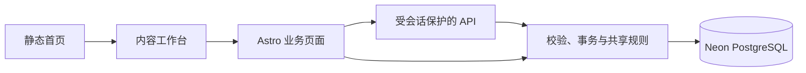

# 架构与代码索引

从功能定位入口，再阅读目标目录 README 和实现。这里维护代码关系，业务口径见 [已确认决定](DECISIONS.md)，字段见 [数据模型](data-model/DATA-MODEL.md)。



## 功能定位

| 功能 | 页面入口 | 主要规则与接口 |
| --- | --- | --- |
| 总枢纽首页 | `src/pages/index.astro` | `src/data/home.ts`、`ContentTunnel`、`src/scripts/home-motion.ts`；浅弧与平带连续循环，后两区采用紧凑阅读布局 |
| 组织与人员 | `src/pages/organization.astro` | `src/data/organization.ts`、`src/db/organization.ts`、`api/organization.ts`；岗位职责、资料与现有账号的多岗位任职 |
| 年度规划 | `src/pages/business/annual-plan.astro` | `src/db/annual-plan*`、`api/operations-annual-plans*` |
| 排期与版本 | `src/pages/business/operations-schedule.astro` | `src/db/validation.ts`、`api/operations-content*` |
| 延期与改期审批 | 排期 Inspector | `schedule-rules.mjs`、`schedule-workflow.ts`、`schedule-delay-cleanup.ts`、改期与逐日理由接口 |
| 统一发布与分享文案 | 排期发布 Sheet 与 Inspector | `publication-workflow.ts`、`publication-link.mjs`、`publication-rules.mjs` 与 `publication` 接口 |
| 推广日度与历史 | `src/pages/business/daily-promotion-review.astro` | `promotion-rules.mjs`、`promotion-state.mjs`、`api/promotion-daily*` |
| 推广日期行 | 每帖未完成日期与今天预览 | `promotion-review-days.ts`、`BusinessPromotionDailyPosts.astro`、`BusinessPromotionMetricForm.astro` |
| 非推广复盘 | `src/pages/business/non-promotion-review.astro` | `stage-review-*`、`non-promotion-workflow.ts`、复盘与节点接口 |
| 周度例会 | `src/pages/business/meeting-review.astro` | `meeting-review-rules.mjs`、`api/meeting-reviews*` |
| 账号权限与全站字典 | `src/pages/business/settings.astro`、`annual-plan.astro` | `taxonomy-store.ts`、`api/taxonomy.ts`、`api/business-settings/` |
| 登录与权限 | `src/pages/login.astro` | `src/auth/`、`src/middleware.ts` |

## 页面与业务边界

- `src/pages/` 组装页面和 HTTP 入口，业务页不静态生成。该目录不放 README，避免 Astro 生成公开路由。
- `src/components/` 保存共享壳层、工具栏、Inspector 辅助组件；页面不复制侧栏结构和样式。
- `src/scripts/` 保存需要打包的浏览器交互；非推广交互也由此目录打包，不在 `public/` 另放一份控制器。
- `src/db/` 保存 schema、连接、服务端事务和可共享纯规则。浏览器只能导入纯规则，不能导入数据库或密钥。
- `src/auth/` 负责账号、数据库会话与角色，API 不接受浏览器传入的角色作为权限依据。

## 关键数据流

1. 新做帖建立帖子身份、V0 和排期；改帖派生 V1+。推广改帖首次发布登记确认继承或新填笔记 ID，各版本按日期独立读取；普通非推广保持原帖身份。
2. 发布登记原子保存项目文档、提取后的帖子链接、发布时间和已到期的逐日理由，允许未来时间并立即显示已发送。旧记录空链接遵循既定边界；改期和已有发布时间更正按账号的操作授权执行，更正必须填写原因。 首次且 `syncToMoments=true` 的登记将两项确认一并校验、存入发布事件JSON，后续更正保留，旧事件缺属性不回填。
3. 推广按日度事实与明确等待区间回放。排期、历史和待办共用有效状态推导；旧团队暂停区间保留在历史回放中，单帖当前安排独立处理。
4. 非推广复盘保存真实数据截止日、曝光／阅读原始量、服务端计算点击率与手填3秒阅读率及修订版本；跳过单独保存事件，不生成指标。
5. 周会引用业务事实并保存不可变定稿快照，修订追加版本；历史导入不覆盖旧定稿。

## 运行与维护

本地 Node adapter、公网 Vercel adapter 由 `astro.config.mjs` 选择。`src/db/database-target.ts` 在连接前校验环境；本机通过 SSH 使用上海 `qiuyun_dev`，公网继续使用原 Neon，测试显式使用本机隔离库。`scripts/development/` 负责开发通道、维护配置、结构核对和样例初始化。

- [源码目录](../src/README.md)
- [维护工具](../scripts/README.md)
- [验证](../tests/README.md)
- [部署](deployment.md)

## 推广阶段与例会入口

- `/business/daily-promotion-review`：每日与历史共用顶栏。`?view=stage` 无快照时带日期转入周例会；已有 review／snapshot 只读，聚合与保存接口保留旧业务兼容。
- `src/db/promotion-wait-ranges.ts` 与 `/api/promotion-wait-ranges`：逐帖区间、次日动作和历史保护；每日和历史的状态入口由 `BusinessPromotionTimeline` 按场景呈现，共用原读写与回放规则。共用时序推导在 `promotion-rules.mjs` 与 `promotion-state.mjs`。
- `src/db/meeting-snapshots.ts` 保留 v2/v3 校验装配；`meeting-weekly-material.ts` 生成 v4 周／月例会候选、区间总量、本帖历史／历史同类与来源指纹，`BusinessWeeklyMeeting`／`WeeklyReviewCards` 承载编辑，`BusinessWeeklySnapshot` 按结果／核心结论优先的阅读层级显示冻结结果，草稿填写顺序保留。`GET /api/meeting-reviews/:id/material` 显式刷新，PATCH 保存／定稿只接收选择与人工内容；图片继续走认证接口。
- `meeting-finalization.ts` 共用会前／会后缺项规则；编辑器先提示并定位，事务内再次核对。来源冲突定位刷新入口，失败保留输入且支持重试；已确认非推广的隐藏字段禁用，不参与整表原生校验。
- `meeting-card-rules.ts` 共用非零事实区间、点击率区间复核、非推广排序、自动标题及半填写事项判断。材料只新增展示区间和冻结当日状态映射，不改原事实；编辑器刷新和保存事务均核对点击率区间，确认后绑定新区间。标准格式的自动标题随成功读取的区间预览，兼容旧草稿标题未同步的情况；自定义名称保留，刷新失败不改名，持久化与区间同事务。

## 共享界面接入

接入管理由 `BusinessJuguangIntegration` 复用设置壳层和 SectionHeader，`juguang-management` 通过 `X-Business-Feedback: local` 在单条授权记录内显示慢请求、逐账户检查和有效期更新，保留已有表格节点。`juguang-renewal` 由独立Bearer校验的Vercel定时入口执行，与人工检查共用 `juguang-token` 及应用锁；`last_renewal`独立显示续期结果。服务器 `juguang-check` 只保存安全摘要，`juguang-usage` 维护接口与业务用途。检查／刷新／锁的隔离覆盖见 `juguang-management.integration`，实际设置页各态与原生授权见 `juguang-management.browser`。


聚光授权确认页`pages/api/integrations/xiaohongshu/authorize.astro`复用Frame、Toolbar、PageHeader、BusinessConsoleFonts及business-form。GET／HEAD不创建state，按钮通过原生同源POST发起；表单使用`data-astro-reload`，避免客户端路由将授权303作为跨域读取。实际角色与原生导航验证见`tests/xiaohongshu-juguang.browser.ts`及对应隔离接口检查。

历史月份兼容由`monthly-arrangement.isLegacyScheduleMonth`共用：2026-11为预排期起点，之前缺少已确认计划时`readArrangement`返回只读`legacyV0`状态，`MonthlyArrangementPanel`沿原V0外壳显示当前排期；`schedule-edit-policy`共用边界并保留原因要求。页面和实际写入同时兼容，不创建计划或确认记录；真实基准／冻结快照仍由原入口读取。

先按[本轮检查选择](../tests/README.md#本轮如何选择检查)确定受影响的共享消费者和验收路径；下列实例及专项覆盖说明用于定位，不要求每次全部执行。首屏、角色、动效与PDF分别按实际变动触发，相关结果在输入未变时复用。

`OrganizationWorkspace`复用公共Toolbar／ViewSwitch、SectionHeader、ToolbarActions和FormSheet。`organization.ts`按已知SSR模型就近编辑，保存局部更新职责、负责人及人员行，不替换公共节点；同路径视图前后退接入`business:local-history-pop`，草稿关闭和导航复用公共确认与退出动画。流程IntersectionObserver只在可见后启动一次，填写和保存不重播。`GET/PATCH /api/organization`复用会话与同源保护，服务端严格校验且仅管理员可写；短事务锁使任职替换与审计前后值一致，重复同值不追加更正。账号权限及现有业务事实不随任职更改。

排期移动与对换由`schedule-placement-ui.ts`接入现有单层Sheet的placement视图；日历使用独立拖放类型，不干扰月计划来源拖放。GET/POST `/api/operations-content/[id]/placement`仅按需读取源帖及目标日，事务内使用现有改期函数、双方资源锁、共享月份门禁和执行历史；请求键收在既有JSON执行历史中，不增加表。普通保存仍走原入口。

`form-changes.ts`用于排期与发布的实际值比较；日期比较拆分控件值，版本／请求凭据排除，逐日理由按所属日期归一化。运营配置、月计划来源和发布复盘计划在实际回填后发送`business:form-rebase`及字段名，只更新未被用户输入覆盖的基线。不得在异步结束时整表重置基线。

例会纸面统一由 `src/styles/meeting-print.css` 维护A4竖版与密度；会议页面正常引入，`meeting-pdf-render.tsx`在其余展示CSS之后内联同一文件。`meeting-print.ts`共享应展开的冻结依据选择器，浏览器beforeprint展开、afterprint恢复折叠和滚动，离页清理；服务端使用同一选择器。打印不改变屏幕布局或读写业务数据。`meeting-pdf.ts`的新渲染指纹区分竖版，同时识别同一冻结来源的旧横版指纹，直接返回旧附件；新版本或尚无归档的版本才使用当前渲染器。

站点图标统一在各 HTML 页面 head 中接入 `SiteIcons.astro`，沿用同一 SVG／ICO 与 Apple 图标及缓存版本。主图位于 `public/images/brand/`，SVG 为三个纯矢量路径，透明 PNG 和平台图标均由该源导出；不将文字稿或内嵌位图当作 SVG 交付。

网页内的品牌图形使用静态React组件 `QiuyunMark`，Astro直接SSR、首页由现有React Island复用，不单独新增客户端岛。`surface="tile"`用于首页、登录和页脚的深底区域，侧栏默认透明；`size={24}`仅用于页脚，其余36px。父级负责8px图文间距与品牌链接的可访问名称，组件负责固定占位、原图比例及浅底板。侧栏的两行文字在同一内部网格中保持原高度，不能由新增图标推移提醒或导航。

各工作台页面在head接入 `BusinessConsoleFonts`，不要在Frame正文后追加字体样式。`business-font-assets.ts` 从固定MiSans CSS与原始WOFF2切片生成静态 `business.js`／`business.css`。head内的普通脚本在正文解析前用二进制FontFace同步准备常用字形，其余由CSS按需读取；不手抄56份声明、不改二进制、unicode-range或字重。Frame直接使用原MiSans字体栈，不按首帧速度选择或锁定另一种字体；首页与PDF保留原入口。`BusinessScheduleNotifications` 的实时状态不占布局行，错误放回首条标签。`pnpm test:first-paint` 在等待fonts.ready之前记录早期画面和实际使用字体，补充最终稳定图检查。

前端任务每次按此顺序接手：读 [DESIGN](DESIGN.md) → 检查下列真实例子和共享代码 → 通过 Props、插槽或业务适配器接入 → 执行[界面验收](../tests/README.md#界面一致性验收)。规则以 DESIGN 为准，此处只维护可直接定位的实例。

| 场景 | 真实实现 | 修改入口 |
| --- | --- | --- |
| 应用壳层与正文留白 | [Frame](../src/components/BusinessConsoleFrame.astro)、[排期](../src/pages/business/operations-schedule.astro) | 各页统一使用`main.business-console-content`与Frame变量，业务样式只作用于正文内部；月度运营由Astro的公共main包裹React Island，React根节点不再限宽或设置页面级padding；推广、例会和设置不覆盖公共main的宽度。`tests/business-content.helper.ts`比较公共正文及真实面板边界；横向裁切使用 clip，避免创建滚动祖先导致覆盖详情打开后工具栏失去吸顶 |
| 说明目录与局部章节历史 | [说明组件](../src/components/BusinessUsageGuide.astro)、[目录控制器](../src/scripts/usage-guide.ts)、[Frame](../src/components/BusinessConsoleFrame.astro) | 服务端按角色输出章节与两处目录，正文保留对照表；窄屏复用`business-popover`。点击push锚点、滚动只改高亮；Frame在公共草稿保护后派发可取消的`business:local-history-pop`，本页认领同路径查询的章节前后退，避免Astro重复换页。离开清理监听、观察器及待执行帧；共享Inspector历史照常处理 |
| 公共标题和视角切换 | [Toolbar](../src/components/BusinessConsoleToolbar.astro)、[推广顶栏](../src/components/BusinessPromotionToolbar.astro) | 命名插槽组合控件；推广 `transition:persist` 保留顶栏及按钮，切换后同步激活态 |
| 已加载详情模板 | [非推广](../src/pages/business/non-promotion-review.astro)、[推广每日与历史](../src/pages/business/daily-promotion-review.astro) | 行 `data-inspector-key`，行内标题／动作按钮加 `data-inspector-trigger`（不重复行键），惰性 `template[data-inspector-template]`，`BusinessInspector parameter="row" templates`；公共控制器在稳定父容器委托事件，本帖局部刷新后仍可打开详情；阅读详情不触发外部草稿离开确认，清理面板时保留其他表单的未保存保护 |
| 业务对象填充面板 | [年度适配器](../src/scripts/annual-plan.ts)、[排期](../src/pages/business/operations-schedule.astro) | `getInspector(element,{render,select})`；排期内联适配器通过 `business:inspector-select` / `business:inspector-render-record` 通信 |
| 统一详情开关 | [Inspector 组件](../src/components/BusinessInspector.astro)、[控制器](../src/scripts/business-inspector.ts) | 几何、单一正文滚动、固定头尾、焦点、历史、dirty、移动端和动效在公共实现修改；静态内容和惰性模板由控制器统一收纳到 `data-inspector-body` |
| 保存与重新读取 | [非推广适配器](../src/scripts/non-promotion-review.ts)、[读取模型](../src/db/non-promotion-read-model.ts) | POST 成功后 `setClean()`，GET 同一读模型刷新行、模板及轮次基准；失败保留输入 |
| 原位分组与查询参数 | [非推广适配器](../src/scripts/non-promotion-review.ts)、[共享 Inspector](../src/scripts/business-inspector.ts) | 分类均值七列单层表头、同类两轮上下排列，`data-category-records` 在所属分类下接收同一批真实记录节点，平铺移回 `data-review-body`，展开不导航；`localParameters`、`setLocalParameter` 与 `onContextChange` 同步 URL 和前后退，保留详情及 dirty 输入 |
| 筛选与展示方式 | [非推广页面](../src/pages/business/non-promotion-review.astro)、[ViewSwitch](../src/components/BusinessViewSwitch.astro) | 条件表单与展示操作分组；单选切换只更新已登记的局部参数，不提交筛选或重建表格 |
| 编辑与发布抽屉 | [FormSheet](../src/components/BusinessFormSheet.astro)、[排期页面](../src/pages/business/operations-schedule.astro) | 插槽内保留原表单与字段，使用 `dialog-head / sheet-body / dialog-actions` 三段结构；只滚动正文，字段与按钮规格由组件维护 |
| 排期单层面板 | `schedule-page.js`、`schedule-panel.css`、`BusinessFormSheet embedded` | 一个BusinessSheet装载详情及两份原表单；getInspector的surface只适配呈现，保留选择／URL／焦点／脏状态控制。内部切换派发schedule-panel-view取消旧读取，返回详情可续读；保存以原月份SSR同步卡片／Week／核对依据，保留整月草稿节点，失败仅重读；慢执行读取的反馈附着正文，不遮盖已知摘要。复盘控件以data-business-eligible合并对象资格和权限，异步权限更新不能重新显示不适用入口 |
| 完整日期时间拆分输入 | [DateTimeFields](../src/components/BusinessDateTimeFields.astro)、[控制器](../src/scripts/business-datetime.ts)、[排期](../src/pages/business/operations-schedule.astro) | 原生 date／time 与原时间戳隐藏字段共用；配置通过 `business:datetime-configure` 或 `configureDateTimeField`，捕获输入／提交同步，动态改期表单克隆同一模板 |
| 字体与详情操作区 | [字体基准](../src/styles/business-typography.css)、[Inspector](../src/components/BusinessInspector.astro)、[统计](../src/components/BusinessToolbarSummary.astro) | 原生控件显式字体；数字正文字体＋tabular-nums；排期／年度 footer 接入 `business-inspector-actions`，通过主要／次要动作类保持层级 |
| 常规表单与日期 | [共享表单样式](../src/styles/business-forms.css)、[设置](../src/pages/business/settings.astro)、[时间格式](../src/scripts/business-date.ts) | 在表单显式接入 `business-form`，筛选使用 `business-filter`；标签、40/36px 控件、只读和反馈由共享规则维护，不影响日历卡片或年度矩阵 |
| 居中编辑与轻量对话框 | [FormDialog](../src/components/BusinessFormDialog.astro)、[年度](../src/pages/business/annual-plan.astro)、[例会](../src/pages/business/meeting-review.astro)、[推广历史](../src/pages/business/daily-promotion-review.astro) | `dialog-head / form-dialog-body / dialog-actions` 三段，宽度按任务指定；长编辑任务使用 `data-form-editor` 保持视口内高度，沿用原 ID、字段及事件，不改变居中与侧边操作习惯 |
| 空态与动态版本历史 | [年度规划](../src/pages/business/annual-plan.astro)、[年度适配器](../src/scripts/annual-plan.ts)、[Frame](../src/components/BusinessConsoleFrame.astro) | 使用共享字体变量及中性次级按钮；动态 DOM 也命中本区块样式，时间明确按上海时区格式化 |
| 持续状态的待办表达 | [待办行](../src/components/BusinessPromotionPendingRows.astro)、[展示模型](../src/db/promotion-pending.ts)、[区域样式](../src/styles/promotion-pending.css) | 首次推广安排使用主表灰行与状态下浮层；活动内暂停／待定接入普通逐日队列，新草稿默认零、已有输入不覆盖，真实跑量计原阶段；主键为活动＋日期 |
| 录入表头与角标 | `BusinessPromotionDailyPosts.astro`、`promotion-pending.css` | 每日与残留补录共用 `.review-entry-head`，标题／单位／说明整组在列内居中；数值输入独立右对齐。例会状态用定位上标，不挤偏主文字；`data-meeting-result` 仅包裹安排纯文本，浮层读取不带星号。阅读型表格按 DESIGN 的同类规则接入，不使用全局居中覆盖 |
| 就近查看帖子资料 | `BusinessPostReferences.astro`、`WeeklyCardDetails.tsx`、`business-popover.ts` | 共享原生气泡开关／定位／键盘与视觉，消费者声明表格或卡片边界；资料只读展示版本文档、排期帖子链接和主体 ID，ID 补填仍委托本行保存。共享行为不复制业务表单 |
| 例会安排原位更正 | `BusinessPromotionMetricForm.astro`、`meeting-decision.ts`、`promotion-editor-lifecycle.ts` | 安排编辑在原行的锚定气泡完成；指标单条与批量保存先处理安排草稿，保存只更新相关行、保留指标／节点／滚动，决定 ID 与版本用于并发校验 |
| 推广状态和历史 | [状态组件](../src/components/BusinessPromotionTimeline.astro)、[适配器](../src/scripts/promotion-timeline.ts)、[事务](../src/db/promotion-timeline.ts) | 每日／历史 SSR 与排期认证片段共用；显式业务日期＋指纹＋请求键，保存只替换本篇行，保留其他输入与公共节点 |
| 申请字段对照 | [SSR 组件](../src/components/BusinessChangeDiff.astro)、[异步适配器](../src/scripts/business-change-diff.ts)、[样式](../src/styles/business-changes.css) | 每个字段纵向展示原内容与申请内容，安全文本渲染，不创建横向表格或嵌套滚动 |
| 排期申请队列 | [审核组件](../src/components/BusinessScheduleApprovals.astro)、[适配器](../src/scripts/schedule-approvals.ts)、[读模型](../src/db/schedule-approvals.ts) | 统一新旧申请，模板复用 Inspector，默认首项和 `request` 深链接；固定 footer 审核，原位更新结果与计数 |
| 读取反馈与取消 | [共享读取](../src/scripts/business-read.ts)、[排期详情](../src/scripts/operations-workflow.ts)、[年度历史](../src/scripts/annual-plan.ts)、[推广刷新](../src/scripts/promotion-timeline.ts) | `readBusiness(target, task, {isCurrent})` 包含 fetch 与解析；500ms 目标区域单反馈，同目标替换取消，落地前复核代次，关闭、导航及模态内部视图离开均取消读取；落地还须核对对象与当前可见视图 |
| 切页细线与交接 | [反馈组件](../src/components/BusinessNavigationLoading.astro)、[导航控制器](../src/scripts/business-navigation.ts)、[细线样式](../src/styles/business-navigation.css) | A方案保留当前页，Frame只挂载一份持久反馈，不维护目标布局、不复制Toolbar、不预读业务数据。Astro loader接管120ms门槛及1200ms短提示，数据与样式就绪就取消未出现的细线；Signal隔离取消和连续切页，实际swap后page-load收尾、180ms正文轻淡入。独立固定层按Workspace及当前顶栏测量，避开玻璃Sidebar包含块；Inspector及草稿保护继续处理本地任务 |
| 工作台材质与反馈 | BusinessConsoleFrame、workspace-glass.css／workspace-glass.ts | data-glass-surface 为全部模块的材质边界，排期局部适配使用schedule-glass；独立入口显式data-surface-press="directional"，控制器不按类名猜测任务，不复制壳层、详情或保存逻辑 |
| 详情资料 | BusinessResourceLinks、推广／非推广详情 | 静态URL与排期dynamic模式共用图形和缺失状态；异步回填消费既有business:schedule-selected摘要，直接链接首次进入补读已有SSR摘要，不请求数据。应发／实发按任务默认可见；表单、权限、复制与保存仍由原业务处理 |
| 验收实例 | [界面浏览器测试](../tests/business-ui.browser.ts)、[排期工作流](../tests/schedule-workflow.browser.ts) | 隔离数据与真实 DOM，检查节点身份、坐标和交互结果 |

非推广的行、标题与末列操作共用同一排期＋轮次键；公共委托允许显式 `data-inspector-trigger` 按钮，原生键盘生成 click，关闭回到实际触发按钮。普通外链仍独立处理。资料由 `readNonPromotionReview` 同时供给 SSR 与认证 GET，包含 `projectDocUrl`、`publicationUrl`、`plannedPublishAt` 与 `actualPublishAt`；使用 `businessDateTime`，排期链接使用应发上海月份＋排期 ID，新标签保留当前草稿。实验日期在同一列同行以两个 `time` 显示上海实发日与共享规则返回的 `dueOn`（7／15天），排序键仍为实发日；保存和分类切换保留日期节点，不改人工填写的 `recordedThrough`。

模板中的业务表单由页面适配器代理事件；`business:inspector-render` 只初始化新挂载内容，不导航、不重建列表。需要异步补充时立即显示本地内容，在请求后比较选择和请求代次，失败在面板内提供重试；排期的 [operations-workflow](../src/scripts/operations-workflow.ts) 是完整实例。

排期 `showPanel` 读取时清空并隐藏待处理分组，收到真实待办才显现，空结果继续隐藏。历史区立即显示标题，以该区为 `beginBusinessRead` 目标，设置 `aria-busy`；超过500ms显示就地读取反馈，成功后再区分非空分组与“暂无历史记录”，失败与只读重试也留在此区。关闭、切帖或离开详情复用原取消与代次校验，不增加请求。`test:inspector-loading` 检查快慢读取期间的实际高度、资料起点与重试、切帖、关闭清理；`schedule-history-feedback.browser.ts`检查双角色紧凑记录和共享查帖呈现。

新增或变更共享模式时同时修改此表及行为验收，避免示例与运行代码分离。服务端读模型只允许 SSR/API 使用；浏览器中的 `import type` 仅提供类型，不能导入连接或执行数据库查询。

局部参数只登记不改变数据集的界面状态；学科、分类仍通过原筛选读取数据，首轮、二轮始终同时保留。分组切换不提交筛选表单、不重建列表或详情模板，指标保存后的 GET 刷新继续使用同一读模型。设计文案仅说明必要业务边界，不能把接入过程或布局考虑展示给业务使用者。

发布流程写入集中在 `src/db/publication-workflow.ts`：统一登记时间和链接，使用排期行锁、发布修订号及更正审计。`publication-link.mjs` 为 SSR/API 和浏览器共用的分享文案识别；`publication-rules.mjs` 维护发布状态与旧空值边界。`operations-workflow.ts` 按待处理／历史分层核对延期理由、提供链接预览并只读展示旧预约历史。原因录入、补登、更正、历史和申请差异共用 `schedule-rules.delayResponsibilityLabels` 的“运营原因／非运营原因”；归属指运营岗位，编辑账号独立留痕。排期及旧修订保存 `delayThresholdHours`，状态、原因和更正统一使用 2 小时门槛；未登记催办与最终延期判定分开，改期审批由服务端按原记录复核。

排期页面的日历日期按钮及空白点击共用 `openForm`，仅传入预填日期；日期与时分组合成原 `plannedPublishAt` 提交，编辑、改帖沿用相同控件。月历与台账复用完成状态计算，推广身份由独立标签表示。验收见 `publication.browser.ts`。

日期格式统一入口为 `business-date.ts`，SSR 与异步回显不得再定义私有格式。面板读取采用 500ms 延迟反馈；Frame 只为写入修改触发按钮。`business-dialog.ts` 维护公共站内确认和 Sheet／Dialog 退出生命周期，删除排期、区间影响、笔记 ID、年度恢复和例会定稿／草稿删除均通过 `businessConfirm` 的标题及动作参数接入；失败由所属区域提供反馈。确认框与其他 Dialog 的 footer 共用 `business-forms.css`，原生按钮也显式使用 40px／13px 规格。Sidebar 的未保存保护交给共享导航控制器，退出成功后再清理 dirty，避免二次触发 beforeunload。业务关闭回调清理 dirty 后沿用公共 close，不直接隐藏 DOM。共享控制器也接管未定制的原生 cancel；已有未保存取消保护的容器标记 `data-dialog-cancel-managed`，由原保护完成确认后调用公共 close。

年度和排期的操作目录在 `auth/business-capabilities.ts`，服务端有效授权与审计在 `auth/business-permissions.ts`；`db/business-approvals.ts` 根据真实差异检查权限、事务预检并保存申请，批准复用原写入入口。`withDatabase` 用请求隔离的异步上下文保证业务写入与申请状态原子提交；不得以临时提升员工角色绕过校验。权限 UI 只负责入口与只读字段，不能替代服务端检查。

排期待审复用排期台账的行、日期分组和共享 Inspector，`BusinessChangeDiff` 为 SSR 差异实例；`operations-workflow.ts` 调用 `appendChangeDiff` 提供同结构异步详情，样式集中在 `business-changes.css`。列表的表格选择器必须限定在 `.table-wrap`，不得撑宽详情。`BusinessPromotionDailyPosts` 委托每日记录呈现首次灰行，`BusinessPromotionTimeline` 历史／Inspector 沿用更正表单与区间；首次资格同时核对排期原状态，历史终态没有活动明细也不能进入首次队列。

首次推广与启用前历史区间的 `.review-arrangement` 显示 `reviewOn`（区间末日次日），未到期时禁用选择与保存；隐藏提交字段 `reviewDate` 仍为区间末日，不能随展示文案一并顺延。`data-pending-editor` 沿用原 API 处理这些安排及兼容历史，不把未来截止日调整误当作实际投放。当前活动内暂停／待定使用逐日 `BusinessPromotionMetricForm`，不套用区间截止日表单；`test:timeline` 与 `test:review-workbench` 分别覆盖首次／历史兼容和当前逐日行为。

`promotion-review-days.ts` 把数据日期、是否到开放时刻、是否被前日阻挡分别计算；`BusinessPromotionDailyPosts` 按可填、待开放与前日未完成归组，`BusinessPromotionMetricForm` 复用草稿、当日状态和成本控制器。`promotion-review-days.ts` 浏览器适配器按服务端上海时间在午夜及返回时重读，原位刷新、保留草稿和展开；今天预览不提供指标提交，日度写入仍由原 API 校验 T+1。`test:review-workbench` 使用隔离服务端时钟与浏览器时钟一起跨越午夜，不能只修改前端按钮验证开放。

面板动效统一由 `business-inspector.ts` 与 `business-dialog.ts` 管理。排期正文使用 `data-inspector-host` 接入共享轨道；Inspector 在实际退出动画结束前保留 `.is-open`，同时收拢停靠轨道和间距，内容保持固定宽度。Sheet／Dialog 等待面板和 `::backdrop` 都退出再调用原生关闭，快速重开废弃旧退出任务。两类容器通过 `setBusinessScrollLock` 共享嵌套锁与滚动恢复，Frame 保留滚动条槽位。不要在页面添加关闭定时器、移除节点或重复锁定；逐帧验收入口为 `pnpm test:motion`。

推广概览由 `promotion-overview.ts` 从原阶段与日度事实计算阶段节点、已登记天数和日期，`BusinessPromotionSummary` 与每日表格、Inspector 共用于每日及历史。`promotion-disclosure.ts` 负责日期行、分类明细和数据表的成对展开；`business-data-motion.ts` 只在真实进入时播放节点，局部保存只强调真正改变的阶段。团队暂停新建／修改接口已停用，共用上下文和锁保留，历史批次通过退役迁移结束有效期而不删事实。

`promotion-audit-view.ts` 只读分类首次安排、业务更正、技术维护及未确认类别，并把快照翻译成明确前后状态；`BusinessPromotionTimeline` 在推广与排期 Inspector 共用此过滤，底层审计不删改。已知技术记录不进入业务历史，新增未知技术类别先询问用户。单日详情只接入当日事件，整篇入口查看全部业务历史；无业务记录不显示空入口。

公共离开保护把 Inspector 选择参数作为本地历史处理，页面其他草稿保留；面板自己的未保存修改继续确认。表格或分区收起后关闭 Inspector，焦点回到所属展开入口。

旧待定初始化使用迁移中原有的扁平日期字段，只表达真实的首次待定安排；旧记录没有逐次操作时间，不能把待定截止日误写成操作日，也不生成相同前后值的假更正。

移动端 Inspector 的焦点范围包含原生 `summary`，排除折叠内容中的字段；Chrome 的关闭 `details` 仍可能保留布局盒，不能只用 `getClientRects()` 判断键盘可达性。

每日表单由 `promotion-daily-form.ts` 管理原行草稿、校验、计算与保存锁；已保存复盘仍使用 `BusinessPromotionMetricForm` 原行，仅以 `data-saved-review` 替代待填标记，`promotion-saved-review.ts` 管理继续编辑、取消、原位PATCH及只读重试。已保存五项输入与次日下拉使用真实disabled，继续编辑才启用；收集值时直接读取命名控件，不依赖原生FormData包含禁用项。锁定外观复用 `business-forms.css` 和 `business-tokens.css` 的 `--console-control-disabled-*`，与首次推广、公共筛选及Sheet共色；不写白底例外，不改变行高或字段位置。两者共用 `openStateBubble`，次日更正原因沿用同一气泡样式及 editor 生命周期，不往表格增加字段。`note-identities.ts`批量读取版本基线与日期切换，`note-identity-rules.ts`供浏览器和事务共用日期解析。`BusinessPromotionDetails`只在选中日详情接入范围更正，`promotion-note-correction`用公共确认和Inspector已有refresh原位更新；失败保留输入，写入成功后重读失败只重试读取。发布单层Sheet通过原workflow读取传递身份预览，`publication-note-identity`保留用户选择，`registerPublication`同事务确认；审批预演及重放沿用同一服务。

`BusinessPostReferences` 仅展示资料，复用 `business-popover.ts` 与例会相同的原生气泡行为。版本行复用 `promotion-pending.css` 的18px行框和4px间距，资料按钮用伪元素扩展至24px点击区域，避免组件外边距与行内gap叠加。表格不再克隆到 Inspector；查看资料不导航或触发草稿确认，缺失 ID 的确认仍只更新本地草稿并随复盘原子保存。

推广精确状态和后继选择共用 `promotion-successors.mjs`；`promotionDayStatusEdit` 排除该日已有覆盖后回放原状态，SSR 和事务共用更正选项，误选终态可恢复该日原状态且不开放历史终态之后重启。状态气泡只传行日期、目标状态与原因，保存后仍显示“修改”，次日安排独立；终态与进行中互改时原位恢复相应选择控件，保留数字草稿。`promotion-residual.ts` 复用日度 API 的笔记搜索／残留保存，明确选择活动与日期后才读取该排期的保存指纹，随补录提交并拒绝旧版本；不批量加载全部候选的历史。服务端稳定归属由日度事实的 `sourceStageStartedOn` 及阶段聚合维护，不以临时阶段行 ID 关联。

### 每日轻量补 ID 与批量复盘

`promotion-daily-write.ts` 复用原单条事务写入；`api/promotion-daily/batch.ts` 先校验事务初始指纹、内容 ID 一致性，再按稳定顺序写入，任何一行失败整批回滚。浏览器只捕获当前 ready 队列，按活动与日期去重，成功用同一服务端文档按 schedule 合并，不替换其他输入节点。

### 周例会卡片与读取反馈

周／月会共用讨论组件的`canFinalizePost`必须由页面明确传入，通过`canFinalizeMeetingPost`按会议类型判断：周会双方均可进入定稿，不能依赖月计划记录；月会首次确认预排期仅管理员，已有预排期后的原修订入口保持。该能力只表达角色／阶段资格，历史只读、到期、缺项、保存中及未修改等条件仍独立生效。服务端`guardedScheduleWrite`保留首次预排期的管理员校验，`changeArrangement`独立校验最终封存，不能仅靠前端禁用。

`meeting-decisions.ts` 仅投影决定策略、生效日、决定数组、撤销事件和必要排序字段，再调用原决定回放；不能因缩小读取而排除带撤销事件的草稿或失效版。`meeting-history.ts` 为周会比较及旧版候选计数投影 JSON，保留缺失／null 与原事实，避免重复传输卡片的比较证据。`monthly-meeting.ts` 的事项读取按上海月界筛选，取每场最新有效会后事项。`content-search.ts` 在 PostgreSQL 内递归匹配字符串 scheduleId，只返回关联例会元信息。

推广日度将已读上下文交给 `readPromotionTimeline`；周会将上下文交给 `readReviewPlanning`，复用仅在本次请求内。例会总览只读摘要，选中后才取该场草稿及当前显示版本的完整快照，其他版本仅取导航、决定与回溯摘要；上一期行动只读行动文字。版本展示、回溯和 PDF 仍读取对应完整冻结快照，保存版本凭据不做缓存。

旧V4草稿缺少缓存材料时仍使用原兼容表单，并保留阶段快照选择器；跳过阶段快照查询必须依据实际展示分支，不能只判断schemaVersion。

周例会 React 岛复用 Frame、Toolbar、BusinessDateTimeFields、表单变量与 `businessConfirm`；异步候选调用公共 `readBusiness`，保留当前人工输入和勾选，区间变动使旧响应失效。条件筛选仅设置卡片 hidden，完整事实／比较来源由服务端保存到 v4 JSON，不增加表结构。新模式用 `tests/meeting-weekly.browser.ts` 验证正式组件和隔离业务数据，旧 v2/v3 与旧阶段只读兼容继续由 `test:reviews` 验证。

例会内联模式：`WeeklyReviewCards` 在卡片确认／修改，`BusinessWeeklyMeeting` 保存未确认草稿并使用公共读取与确认反馈；CSS Grid 依据内容容器组织当前双卡／单列，记录自然高度；阅读及比较规则统一参见 DESIGN“会议阅读与编辑”。`PATCH /api/meeting-reviews/:id` 的 `finalize_version_draft` 的 pre／post 分别冻结材料和发布次日决定，`meeting-decisions.ts` 按生效日合并不可变版本；`promotion-review-days.ts` 将决定接入每日表单，`meeting-decision.ts` 只在填写理由后更正并保留数字输入。`tests/meeting-inline.browser.ts` 验证正式组件、跨日、内联草稿与锁定，`meeting-decisions.test.ts` 验证版本优先级及终态日期。

例会明细使用 `WeeklyCardDetails`＋`meeting-layout` 的原生非模态 popover，编辑与无 hydration 的冻结卡共用；触发按钮留在原位，不测全页卡高。Toolbar 的 `layout="title"` 为没有居中控件的对象页保留完整标题宽度，不改变公共高度。`meeting-note-ids` 通过 SSR 与 material GET 的独立 `noteIds` 返回实时主体 ID，不进入材料、指纹或新冻结快照。

`readWeeklyDraftStates` 仅用于可编辑例会的 SSR 与草稿保存兼容，缺状态时才批量读取推广上下文，按活动＋日期查真实日度并回放；只增加缺失的 `dailyStates`，不改 facts／总计／指纹和人工值。无对应记录不回填，冻结视图不调用；新材料仍由 `readWeeklyMaterial` 完整生成。

最新延期计算仅接收当前排期；改期与实发更正共用 `pruneScheduleDelayReasons`，在原事务锁内删除失效原因及审批／推广快照中的结构化副本。旧排期提交被拒绝，审批快照只读取当前修订；请求清理按 Content-Type 解析，兼容 multipart。改期理由和其他业务事实保留，不能整条删除审计或改写自由文字。

例会非推广的日期使用共享 `checkpointsForPublishDate`，待填与二轮前置首轮均取各自到期日，不使用会议结束日。`meeting-non-promotion.ts` 同供浏览器与事务确定本期必纳入引用；服务端仍检查全部 pending。`readWeeklyPostDetails` 在 SSR／材料刷新中批量读取推广、非推广与待处理节点的笔记 ID 与当前资料，和指标指纹分开；冻结视图只读获取当前链接，不回写快照。`WeeklyCardDetails variant="info"` 由两类卡片共用标题文字后的资料气泡，底部明细保留原触发方式，定位、悬停／聚焦、点击保持与关闭统一由 `meeting-layout` 管理。

规划内联字典接入：`annual-plan.astro` 的 `taxonomy-field` 在字段下展开，`annual-plan.ts` 调用管理员 `/api/taxonomy`，以 `taxonomy-store.ts` 统一追加、重名复用及学科关联。排期校验、复盘筛选与审批名称从数据库字典读取，`taxonomy.ts` 仅供初始化及旧纯规则测试。`settings-taxonomy-retest.browser.ts` 验证输入保留、失败重试、全站可用与权限。

规划共享校验将已合并的旧讲义分类编号归一到现有“非推广讲义帖”；旧页面提交、历史恢复及审核重放复用该入口，保留原快照JSON。`annual-plan.browser.ts` 实际恢复旧分类快照并核对当前关联及原版本不变。

推广轮次由 `promotion-cycles.mjs` 从已确认复测动作计算，日度以 `sourceStageStartedOn` 记录所属轮次；`promotion-replay.mjs` 分离复测动作与实际状态。例会决定保留可选action，不能把复测压成普通testing；`settings-taxonomy-retest.test.ts` 与浏览器专项覆盖100/30、暂停恢复、次日生效、同日去重及冻结版本。

`WeeklyMeetingPresentation` 共用会前／会后阅读、最新版本编辑与打印布局。`BusinessMeetingDiscussion` 监听公共 `BusinessViewSwitch`，默认只读，保存 `save_version_draft` 首次建立下一版草稿，重复保存更新同一行；`finalize_version_draft` 按 pre／post 在同一行定稿。`meeting-version-workflow` 事务锁定来源版本与更新时间，合并白名单、固定生效日、记录事项前后值；`rollback_version` 仅生效日前确认回溯，保留失效版本并创建待重新定稿的会前恢复版本。`meeting-decision-rules` 跳过失效版本与纯文字继承事件，防止重复执行或盖掉日度更正。

`meeting-rate-comparison.withFrozenRateComparisons` 只从旧定稿自身材料补齐缺失比较信息，页面和PDF共用，不查询实时指标或写快照。主值旁常显同类pp；推广精确基准保留原始记录，非推广精确基准／区间／样本在原有详情分别读取，不在主值下堆辅助行。`metric-change.css`让文字提供真实基线，箭头只在同行盒内定位；网页与PDF共用。

`meeting-pdf-render.tsx` 将同一React展示组件、共享视觉变量、打印样式及MiSans内联，以本地serverless Chromium打印A4横向报告，按内容与分页组织。禁止外网请求，不复制登录会话；`meeting-pdf` 按内容／模板指纹和版本租约生成，成功替换旧自动文件，独立上传保留。`MeetingPdfArchive` 仅在总览和折叠历史中提供操作。`tests/meeting-discussion.browser.ts` 与 `meeting-version-workflow.test.ts` 覆盖新模式、冻结、期限、回溯和打印流程。

版本草稿接入：`lifecycleStatus` 与 `finalizationStage` 分别表达是否定稿、会前／会后，`activeMeetingDraft` 选择续填入口，`currentVersionNumber` 仍指最新有效定稿。初始编辑器通过 `WeeklyMeetingPresentation` 的卡片插槽复用正文与事项表；修订只合并白名单。草稿不参与均值、决定或 PDF；回溯的撤销日志独立保存，不能依赖可编辑快照执行。`meeting-draft-migration.test.ts` 覆盖兼容迁移；编辑表格测真实控件中线，率与 pp 测默认态相邻可见和溢出，五档截图仍需人工审阅。

`meeting-discussion-values.meetingDiscussionKey` 在浏览器及修订事务共用实际值比较，忽略空占位、对象键序与首尾空格；打开编辑器不置脏，改回原值取消未保存状态。初次建修订草稿及每次定稿接入 `businessConfirm`，同版草稿正常保存；事务拒绝空修订，允许现存草稿同号定稿及会前转会后维持原方案。待确认草稿的安排优先于执行快照，避免重开时被旧决定覆盖。

### 数据区块操作与首次安排接入

`BusinessSectionHeader` 的 end 插槽可以是只读统计，也可以接 `<BusinessToolbarActions slot="end" variant="section">`。区块主按钮使用 `primary-action`，轻量按钮和链接无额外 margin；标题、计数、图标和状态变化均验收真实文字中线与可见12px间距。历史筛选的查看／重置共用同一操作组，年度新建的文字与加号由父级 gap 管理。顶部已有消费者省略 variant，保留8px间距及原样式，不将只读统计换成按钮。

每日 `BusinessPromotionDailyPosts` 用 `promotionReviewQueue.main` 在同一 `review-entry-scroll` 内渲染可填、已保存指标和 `BusinessPromotionInitialRow`；`ready` 与 dueCount 继续只统计待填指标。页面已读取的完整 metrics 传给 `promotionReviewDays`，`retainsDailyReview`按上海日期仅保留昨日事实，忽略旧日的更新时间，不扩大公共context查询或增加轮询。原活动＋日期节点在首次保存后保留；编辑中的已存行不被重读覆盖，自己的状态保存以新指纹同步上下文，其他草稿／焦点／滚动保留。初始灰行没有 `data-metric-form`，禁用框无提交名称，不伪造零。状态浮层复用 timeline 保存、公共确认与 promotion editor 生命周期；后者独立于右侧 plan 表单。保存成功通过 `business:operation-receipt` 复用公共通知外壳，不增加一行反馈占位。排期／历史的 `BusinessPromotionPendingRows` 保留自身布局，不复制主表DOM；历史日期与选择按160px可读字段组换行，明确覆盖公共表单的 min-width:0，不能只检查无溢出而保留被裁切的日期。

新首次待定用显式 null，省略字段保留旧接口语义。只读模型区分尚未安排与计划已存但截止为空，T+1按业务日期推导，不能按点击日重写草稿日期。局部刷新保留稳定记录键、其他指标节点、焦点及滚动。修改本流程或其共享布局时，按受影响状态与断点检查保存、灰行／真实零值、截止条件、失败重试及草稿保护，实际查看相关图像和必要过程；不固定扩展到五档全矩阵。

共享数据界面的条件态接入：`BusinessPromotionInitialRow` 的下一步日期仍属于原 plan 表单，只通过 `data-deadline-panel` 原生手动气泡查看／编辑，不嵌套表单、不增第二次保存；控制器负责开关、焦点、视口定位，关闭不清空字段，取消才重置该行。`promotion-timeline` 继续负责唯一写入及空截止语义。日期气泡、取消及出错都必须与默认态对照实测，字体与尺寸要在公共 business-form 样式生效后读取。

排期普通／审批台账共用语义列锚点，资料链接通过自身位置居中，不能只改td文本对齐。移动台账保留卡片布局，时间按完整时分和实发说明分配72px，版本按三字工作类型及内距分配48px，显式覆盖桌面内距；名称与状态共用左锚点，不照搬桌面短状态居中。非推广整行表头及排序继承同一字号，样本／动作按实际内容最小宽度分列；推广只读阶段列容纳最长状态，例会PDF查看／下载直接显示，维护动作进入更多气泡，错误位于所属记录；手动附件复用 business-popover 的顶层气泡及视口避让，避免被横滚容器裁切。权限表分别声明列宽、表头与行标题，不给所有th套同一宽度。审批差异表保留字段与前后值的可读最小列宽，窄屏横滚，不把长字段名挤成一字一行。排期统计条按标签、数字和内距的实际内容确定卡片最小宽度，标签＋数字使用flex整体居中、间距8px，不让数字跨空行或让辅助说明撑开主信息；推广细分直接使用相邻测试／放量卡。空间不足内部横滚，不截断标签或将四字名称拆行。交互计数半角括号同时检查SSR与脚本回显：每日“一键保存 (4)”由页面和promotion-daily-form共同输出，历史分组、查帖和例会折叠入口采用相同格式。年度矩阵及月历保留自身结构，按名称、日期、状态的语义规格验收。

### 协作与来源准备接入

动态业务导航不预取HTML，实际点击、筛选和前后退仍走ClientRouter。排期页把已计算的提醒通过共享Frame／Sidebar接入，首屏直接显示计数，并在持久化侧栏接收新页面快照；没有该快照的页面仍请求提醒API。提醒查询只投影当前判断必需字段，不读取改期历史、理由正文或更正历史；具体内容仍在原详情入口读取。每分钟、返回及保存后的提醒更新与权限校验保留。

暂停实时共享时也不加载协作样式，避免旧占用容器的定位规则干扰业务气泡；原脚本、样式和表保留，恢复时须整体重新验收。

- `BusinessConsoleFrame` 接入查帖、公共确认和 `business-save-conflict.ts`。`editing-policy.ts` 统一暂停实时共享，`business-collaboration.ts` 保留但不初始化监听、定时器或取锁；例会共享提示不渲染。现有 `data-collaboration-resource` 保留为稳定对象标记，也用于冲突后停止该对象自动保存，不作为占用展示。
- `collaboration-resources.ts` 共用写入目标映射，`collaboration.ts` 保留事务级 `lockWriteResources`，只在保存期间保护“读取版本、比较、写入”。中间件在审批截取请求之前校验排期凭据，`schedule-write-version.ts` 与页面内容同次读取；各业务继续使用修订号、更新时间或来源指纹，补齐删除、恢复、状态更正与批量校验。旧协作API直接410，旧租约头不能绕过新协议。
- `meeting-readiness.ts` 共用例会缺项口径，`promotion-review-required.ts` 共用日度应填日期；例会仅引用 `non-promotion-record.ts` 指纹对应的正式事实。准备区只提供原入口链接，不能重新复制指标表单。
- `BusinessPostLookup` 与 `post-lookup.ts` 只读查帖；动态生成的结果使用专用全局样式，避免 Astro 作用域属性缺失导致后加载节点无样式。

### 阅读表与归档动作

例会总览和历史版本共用 `BusinessMeetingRecord` 与 `meeting-records.css`：名称／版本及状态在前，会议时间、区间和周期分组，读取／维护分级。`MeetingPdfArchive` 继续负责同一份归档状态，查看／下载直接显示，生成／上传委托原接口；公共气泡 `data-popover-kind="actions"` 使用176px紧凑宽度，保留原键盘、焦点和避让行为，其他资料气泡规格不变。草稿删除沿用原权限与公共确认，成功移除对应记录，列表空时原位显示空态。修订草稿入口与已定稿PDF版本分别标明。

`BusinessSheet` 提供原生右侧抽屉外壳与单正文滚动；`BusinessFormSheet` 保留兼容表单包装，`BusinessPostLookup` 使用深蓝助手头部及直接正文，不放假外层表单。查帖控制器在跨页时清理委托监听与旧请求，结果位置只在列表进入详情时记录。

`BusinessAssistantEntry` 共用桌面侧栏与手机账号菜单入口，`data-post-lookup-open` 直接打开Frame中的 `BusinessPostLookup`。`post-lookup.ts` 维护展开状态与原触发焦点；手机原生账号popover关闭后返回其账号按钮，Astro换页清理监听并重置持久侧栏入口状态。首屏引导和未开放能力与结果／详情分开显示，分页、版本回退及原页草稿沿用只读控制器；不新增悬浮菜单、页面宽度补偿或独立查帖流程。`test:assistant` 验证五档真实页面、短窗口、触屏、查询失败与草稿连续性。

首次输入不再申请编辑租约。新写入口必须从显示给用户的同次读取取得版本凭据，成功后采用本次返回的新版本；片段刷新保留未保存表单原来的凭据，禁止在提交前取最新版本后强行保存旧输入。

非推广列表布局集中在`non-promotion-table.css`，沿公共正文全宽组织。待复盘表头及`NonPromotionReviewRow`直接不渲染结果单元格，按帖与手机布局同步去掉空指标轨道，完整录入继续使用原Inspector；历史缺值统一“—”，SSR与保存刷新同步，主值、细轨及样本各自共用轨道；跳过视图向共享表头传`skipped`，渲染原因而不生成MetricCell。保存刷新只更新实际存在的指标节点。例会列表沿正文边界使用白底区块，名称与版本组成主入口；历史保持两层折叠、版本项复用同一记录外壳。稳定截图复用测试辅助`settleBusinessUI`等待字体和有限动画，动态过程另行录像，仍须实际打开图像和审查关键录像。

非推广分类汇总和展开明细由同一 `.review-table` 负责宽度，只有外层 `.table-scroll` 横滚；平铺窄屏卡片仍独立适配。例会记录通过 `MeetingPdfArchive` 将直接读取与更多维护分级，详情版本栏保持自身布局。

账号或用户名登录由 `auth/auth.ts` 在原认证钩子中解析为登录账号，密码及会话仍交Better Auth。管理员集合POST与对象PATCH共用provision、输入约束、现有事务锁及数据库唯一保护；管理弹窗沿用公共容器，新建行复用 `BusinessAccountRow`。真实迁移触发器需在隔离夹具中加载，不能只依赖schema生成表。

发布朋友圈确认由排期表单按当前对象配置显示／禁用，`operations-workflow.ts` 提交捕获阶段执行组内校验；`publication-workflow.ts` 在锁定排期和修订检查后按实际要求再次校验。`momentsSentConfirmed`／`momentsRequestSentConfirmed` 为表单布尔值，仅首次必需；发布事件before／after的可选 `momentsConfirmation` 保存两项true并在更正中继承。审批快照只有确认存在时才增加同名键，避免改变历史申请指纹；差异、排期历史与查帖历史呈现运营确认，后续事件前后相同时不重复展示。

统计摘要接入：排期使用单行居中内容组；例会`.weekly-results`建立行内尺寸容器，宽度不足760px时将四项指标按两列组织，保留原字体与打印布局。协作写入从单轮扩为整篇时须取得覆盖整篇的租约，重叠的子级租约只表达冲突关系，不能充当上级写入权限。

### 月度运营与月会接入

`src/db/monthly-operations.ts` 同时服务 `/business/monthly-operations` 的SSR和 `GET /api/monthly-operations?month=YYYY-MM&subject=…&category=…`，共用查询边界校验、延期规则、推广回放／轮次及 `promotionTotals`。页面由 `BusinessMonthlyOperations` 保持筛选、图表和明细节点，异步刷新调用公共 `readBusiness`。费用按日度事实日期，不复用例会候选汇总；归因按当前修订，不以操作人推断负责人。原记录链接使用排期 `row` 选择参数。

延期归因在读模型集中生成：`scheduleRows[].delayAttribution` 为`operational`／`nonOperational`／`unknown`，非延期记录为null；`publication`补充`operationalDelayed`、`nonOperationalDelayed`、`unattributedDelayed`与`operationalDelayRate`。这些计数仅含当前应发月的已发布延期任务，原`operational`关注项保留含未登记任务的语义。全部／运营延期率均除以`registered`。卡片、分布和`operationalDelayed`明细使用同源字段；卡片选择为组件本地`delayScope`，只改卡片，不触发请求、明细切换或图表重播，业务筛选与刷新不重置。

桌面激活侧栏月度入口，手机放在现有账号菜单；查看不建立编辑租约，私域普通写入按最后成功保存生效，保留角色校验、短事务锁及历史。`pnpm test:monthly` 使用隔离PGlite验证接口、双角色和五档视口，纯规则见 `tests/monthly-operations.test.ts`。

侧栏新增同组模块应加入 `BusinessConsoleSidebar` 的 `groups.modules`，复用同一渲染和4px组内间距，不能在分组外追加独立链接。月度运营属于“复盘与沉淀”，手机继续在账号菜单进入；移动底栏的既有项目数保持。

非推广计划集中在non-promotion-plan.ts，浏览器安全的节点、窗口及类型键在non-promotion-nodes.ts；读模型统一原帖锚点，旧版本仅历史。BusinessNonPromotionPlanFields供发布登记及排期Inspector共用，non-promotion-plan控制计划／节点维护；不复制指标表单。标准键day_7/day_15保留，自定义使用custom:<UUID>并关联独立节点。保存、租约、跳过恢复、查帖与例会都使用根排期＋节点键。API非推广录入使用nonPromotionItemSchema计算点击率，SSR／GET共用readNonPromotionReview。

WeeklyReviewCards按contentId分组，selectWeeklyMaterial把同帖对照及未来占位冻结到新快照；readWeeklyMaterial只把启用且已到开放时间的缺项列为pending。自定义不入普通基准，历史修订不参与新样本。非推广发布计划与节点变更接入schedule.edit及审批重放；旧审批空新增字段通过nonPromotionSource保持指纹。

运营类型贯穿接入：`operation-types`维护四种类型与标签；`operation-setup`保存原帖策略和未发布的日期草案；`non-promotion-plan`从统一推广回放推导持续资格。新建、编辑、发布、节点和指标接口共用这些入口，不在按钮事件里自动改用途。`BusinessOperationFields`接入新建／编辑，`BusinessReviewDateAdd`供排期详情及非推广待安排气泡复用。节点写入先取得推广工作流锁，再锁排期／原帖并复核资格。首次实发才将即时草案变为真实节点；普通非推广改帖沿用原锚点；推广后持续由`switchContinuousReviewCycle`在实发事务记录当前版本，`anchorReviewPosts`按实际生效时间解析资格。

非推广结果接入：`NonPromotionReviewRow`在分类明细、平铺和按帖视图复用真实行与Inspector键；`NonPromotionCategoryMetric`接收读模型的阅读量均值及各指标有效样本，客户端不另算入样条件。`mode`控制方式，`group`控制常规历史展示；服务端返回`sampleRows/categoryGroups`，分类共享标准样本与平铺方式过滤分别执行，切换只移动原节点。`NonPromotionCategoryMetric`在缺值时隐藏重复的有效零样本，有值而样本不完整时仍显示依据。`NonPromotionReadingTrend`与保存刷新共用纯函数`non-promotion-trend`，按真实截至日定位并在缺失处断线；`business-data-motion`仅在首次可见时绘制细轨／趋势。


月度贯通的共享入口：

- monthly-workspace／monthly-private 维护同源月份统计，人数普通保存以最后成功值为准；MonthlyPrivatePanel 复用公共 Sheet。
- monthly-meeting 生成月度材料；当前未封存会议读取最新材料，但已确认预排期的draft.monthlyPlan必须来自plan.content和additions，不能用arrangedContent提前替换。arrangedContent仅在管理员confirm封存事务中把实际月历转成最终基准。历史带material=frozen及已封存仍读原快照。MonthlyMeetingSections的计划在预排期后只读，网页与PDF继续复用。
- monthly-arrangement 读取投影后的活动月排期、生成结构指纹及最终实际计划；POST /api/monthly-plans/:id/arrangement 的 submit／return／confirm 事务串行化整月提交与单帖变动，确认时建立最终冻结版本。
- schedule-edit-policy 同时接入 middleware 和 business-approvals 重放；检查前后月份与共享内容影响的全部版本。review_pending 保持员工排期编辑权限，confirmed 的普通调整要求理由并直接生效，取消仅管理员；封存会议普通写入仍拒绝，只有revise_sealed_text经独立白名单事务可更正两项总结文字。
- MonthlyArrangementPanel 通过默认slot包住原月历／台账，阶段标题、Week计划、日期格、核对表单共用边界；撤下列表与入口已移除，旧cancelled查询转回普通月历，查帖不再链接已撤下的排期；推广视角透传slot，不增加无关阶段。MonthlyCalendarPlan 按monthWeeks以五条紧凑行呈现：208px左列集中周次、日期和数量，右列标签全量展示并仅在本周换行；共用说明／选择底栏，CSS替换提示而不复制选择状态。新做、遗留、指定仍归周；compactPlanItems仅合并无独立进展的新做，实际已安排／待审不能再作新建来源。monthly-arrangement 在原格网拖动、原表单落实，保存同步清单与计数；定稿冲突才一次性重读核对，不重挂日历。monthly-calendar沿公共readBusiness自动补读，失败才显示来源重试，切月及离场取消旧响应；空同日提示不渲染，不复制Inspector。旧 links 接口仅兼容首轮执行关系，不改最终基准。
- operations-content DELETE 仅设置 cancelledAt，撤下预约／待审并保留原帖与历史；executionHistory 的前后内容由排期Inspector和查帖共用展示，withoutLegacyDelay 对新默认空值保持旧指纹兼容。

内容职能接入：`content-roles`共用固定选项、分组键与`sameNonPromotionCohort`；`BusinessContentRoleFields`及`operation-setup`只在两个合集显示单选，`content-role-workflow`在原排期事务保存并记录业务更正。新字段为空不改变旧审批指纹。`non-promotion-read-model`、指标保存及`meeting-weekly-material`共用职能入样条件；持续指标保存预期起点，旧数据以已存`statisticsFrom`冻结与展示。`BusinessUsageGuide`向全员提供公共操作与权限说明，维护章节及目录由服务端仅向管理员输出，settings管理入口保留原门禁。

改帖资格由浏览器安全的`content-version-rules`统一计算：仍有未取消排期的最高版本决定`isLatestActiveVersion`，所有历史版本决定`nextVersionNumber`。排期SSR只补读版本ID、内容ID和编号；入口、表单及实发局部回显共用`canCreateRevision`。创建接口在原事务锁内重新读取同一内容的全部版本及有效排期，取消来源拒绝，编号不回收；不修改取消记录或已结束推广事实。

标准基准资格由`anchorReviewPosts.standardCohortEligible`统一推导，读模型、指标保存与例会材料复用；客户端使用服务端`cohortEligible`组织原位明细，不将推广后持续遗留的标准事实重新归入分类均值。

持续每周安排接入：`continuous-schedule`统一保存版本最终日期及协调真实节点；推广日度、时间线、待定区间和排期修改在原事务内调用，读取不生成节点。`BusinessOperationFields`显示最终日期；审批快照复用排期字段，旧NULL字段不改变待审指纹；普通／旧持续计划保留原日期入口。

月度结果与计划接入更新：

- `readMonthlyWorkspace`同一份推广来源派生所选月、全站核心及上月结果；`core`始终全站，`spend`等原字段保留明细筛选语义。有效推广用途共用当月实际日度事实形成的`categories`及已填人数行，不能使用混有排期和活动重叠的`promotionScope`代替实际推广。六个月序列复用同一次推广事实读取，私域月份与费用映射批量读取。
- `MonthlyCoreResults`用于看板和`layoutVersion:2`月会；历史复用静态`BusinessFormSheet`，只读查看不取编辑权。月会材料冻结`core.comparison`并纳入指纹，读取时间不入指纹。空跑来源链接一并冻结。
- `MonthlyPlanEditor`填总数直接维护稳定名额，源表拖动每次分配一篇，已有帖子多选复用同一名额；Week移动只改`week`。旧名额、已提交关联、首次定稿时间、追加批次均保持。自动保存捕获当次草稿，响应不能将请求期间的新输入标为已保存；失败不循环重试或禁用正文。
- 新月会准备、服务端定稿及执行决定同用月度结构分支：不能只隐藏卡片仍执行旧决定。周会保留原口径，按帖双卡或单列展示节点与常显比较，不以全宽或等高作为通过条件。

```tsx
// 核心结果用统一范围，明细继续使用workspace中受筛选的字段。
// 月度运营在原双图之后接入，内部共用六项结果与趋势。
<MonthlyPrivatePanel data={workspace} admin={admin} onSaved={refreshMonthlyResults} />
```

月度展示接入：`BusinessMonthlyOperations` 保留四项执行KPI、关注条与双图，私域在明细前。图表播放绑定成功显示的 `data.query.month`，布局阶段准备待播放状态并在可见时播放；不重挂报表，原请求代次继续阻止旧响应。月会通过 `MonthlyCoreResults` 接入共用 `MonthlyCostResults`，历史Sheet直接使用其`summaryOnly`分支，仅呈现六项主值及必要人数，不渲染趋势、比较或来源表；推广总消耗和平台两项成本独立判断上月比较；三项私域成本要求两期来源口径一致，人数只作依据。可选`core.costHistory`包含最多六个月五项成本，另有可选`spend`保留总消耗走势的旧快照兼容；进入材料指纹；旧快照没有该字段时保留原组件。`MonthlyCostTrend`逐项裁剪首尾空月，至少两月时渲染56px `SparkTrend`的`sparkline`呈现，0／1月显示“暂无对比数据”；真实0计入，内部未知断线。数字按内容占宽、图填满相邻余量，20px列gap管理间隔，不重复名称、月份、坐标轴、金额范围及高亮带，公共气泡保留。`MonthlyCoreResults`在结果表下接入同一来源展开组件，月会不再另列来源卡；打印显式展开`.ps-disclosure`。`SparkTrend`图高和范围动画键沿用既有能力，其他消费者默认行为不变。折叠来源复用`.ps-disclosure`的44px入口，`.ps-group`完整表格的间距不流入折叠分支；展开表格独立12px／20px间距。

月计划会议阅读由`MonthlyPlanSummary`的cards变体按Week展示紧凑名称卡，资料在共享气泡；其他执行摘要保留group汇总。原计划和追加在会议中投影到同一块Week板，写入仍归属各批次。`MonthlyPlanEditor`以editorSteps记录确认数量／分周／已确认，确认回调复用父会议保存，不创建第二套写入接口；新做量与遗留相加、已有排期占名额。编辑时读取当前执行数据，只读仍使用冻结材料。执行摘要复用`readMonthlyPlan`，新月度材料可选携带`executionPlan`并冻结；原快照没有登记状态时显示未记录，不查询当前数据库回填。编辑来源池常驻，不维护折叠状态；桌面绝对定位的pool-shell跟随Week高度，scroll子容器滚动，窄屏按SSR已知周数与Week最小高度在CSS中确定高度上限，避免常驻池在水合后重新测高跳动。编辑接收区最小高度108px，只读及打印保持原紧凑规格。气泡接入data-popover-scroll-boundary，触发点滚出池时关闭。上月未登记候选在数量阶段顶部显式勾选，未选择不占名额；既有遗留关系保持，新选择的真实排期可用独立来源组承载。新／遗留为独立展示标记，名称保持原文。来源池新做组使用PlanQuantity横排减号／可输入待分配量／加号，各阶段保持同一位置与顺序；每次拖动解析一个真实item ID，归零禁拖但仍可增加。遗留和已有排期各自独立且不重复生成。周次与移回使用同一写入函数，默认不常显下拉。新增保留旧分配，数量器只增减未分周的未关联新做名额；具体名额、遗留、审批、跨周和48小时在气泡内查看，不新增负责人。BusinessWeeklyMeeting明确传入planEditing，只读草稿不冒充编辑布局。会议草稿保存由React管理局部状态，BusinessWeeklyMeeting和BusinessMeetingDiscussion的写入带X-Business-Feedback: local；共享Frame跳过最近触发器的按钮改写，认证失效仍由公共提示处理。

周度总览读取`meeting-report-metrics`的全量事实，原summary及阶段卡语义保持。`WeeklyResultOverview`和`ReportCharts`负责差值与真实日期走势；总览逐项显式标记最后一个有值点（0有效），历史点显式为false，不使用复盘区间重叠判定当前点；竖向底纹仅在总览作用域隐藏，其余趋势接入保持；新增字段仅进入新快照。`MonthlyOperationsCharts`由共享发布及投入面板组成：月度运营继续双图并接定位回调，月会将发布与四张执行数字卡并排，投入移到分类区，避免复制图形或让表单按钮规则覆盖只读图例。`MonthlyReportVisuals`消费同一空跑与分类读模型，周构成及可选的五个月空跑序列保留在月度材料中，历史序列复用一次事实读取按月份构建；PDF复用组件及编译后图表样式。空跑来源预览5／3条，金额默认仅本月；标题旁WeeklyCardDetails info以当前行作为boundary，完整资料与整轮依据按需显示。只读资料触发器带键盘语义，在禁用编辑fieldset中仍可读取，不参与导航。完整冻结名单通过页面公共Sheet显示，保持相同排序和行布局，正文一层滚动、关闭回原按钮；打印另输出资料链接。周会`leadCostTrend`从真实定稿选出的同原帖同阶段记录构建，按版本／区间去重，不直接使用含累计摘要的`ownHistory`；图点通过共享资料气泡支持悬停、键盘和点击。

月计划快捷接入：`compactPlanItems`只合并同来源／种类且无独立排期或审批进展的展示，不改变ID。编辑及只读Week板共用分组；左侧`data-plan-return`右上角叉号直接调用分周函数移回一篇，右侧`PlanQuantity`桌面采用88×28px浅边框数量器、触屏保持原点击范围，只改变未分配新做名额及组总量，已分周和已关联项保留。按钮／输入不参与拖动，0时只有减号禁用，来源加号仍可恢复。遗留只有一个真实名额，不提供数量器。已提交／生效／锁定继续保护。`confirmed`可保存未分完的草稿，拖动或调量后回到分周但不重开数量表；会后定稿仍走服务端完整性校验。

保存连续性：过期对象在公共请求层停止自动重试，提示刷新；其他对象的版本独立。旧实时共享控制器只作保留实现，当前不调用ensure、恢复、接管或释放流程。

首页封面交互：`ContentTunnel`的外层figure继续承接统一相位与循环变换，`data-home-cover-face`内层承接指针3D弹簧。`home-motion`复用同一rAF与可见性生命周期，以外层命中区域跟随静止光标，暂停仅冻结横向相位；减少动态效果、粗指针、隐藏和回收清理材质层，不建立第二个永久动画循环。

推广历史单日更正由 `promotion-day-edit.ts` 在事务内读取相邻有效状态，`promotion-day-rules.mjs` 校验两条衔接；`api/promotion-daily/[id]` 及已登记日的 `promotion-timeline` 共用该服务。`BusinessPromotionMetric` 只显示当日安排，原生状态选择和指标共用既有表单；`contextRequired` 返回三天上下文，客户端使用公共 `businessConfirm` 后带 `confirmDayContext/contextFingerprint` 重交。仅选中日状态及派生阶段重建，后续原始记录与冻结会议不改；旧 reviewDecision 字段仅为存储衔接和旧表单兼容。初始日期等重建仍使用 `promotion-history-correction.ts` 的独立影响预览，不混入历史单日流程。`promotionMetricStatus` 继续统一表格、Inspector及新会议材料的有效状态。

每日已保存行显式提交 `dailyWorkspace` 与次日决定时，同一服务才启用 `nextDecision` 分支，服务端复核保留范围；旧历史表单仍只更正所选日。更正次日先验证前一日→当天→次日，次日已有指标时继续验证其后一天；保留人数／消耗和真实重测边界，不归档删除后续事实。`daily_review_correction`审计记录明确的当日与次日有效前后状态。状态不变的指标更正不弹状态确认；一次成功写入后读取失败仅重读。

### 私域来源接入

`monthly-private-sources.ts` 负责来源格式识别、按人次汇总、缺值传播及成本差值；`readMonthlyPrivate` 联合当月真实日度用途与有任一已填人数的保存行，无事实全空占位不入样；未填的实际推广用途仍保留空值。保存规范化使用当月事实的学科／分类去重查询，不为保存读取完整工作区。`sourceData` 是新来源结构，`data` 是只含推广的兼容投影；非推广绝不进入其总计。来源目录只用于复用名称及稳定ID，加入月份时三项人数重置为空。

月度运营使用 `PrivateSourceEditor`，复用页面已有 `BusinessFormSheet` 容器、`business-dialog` 退出和公共未保存确认；固定头尾、正文单层滚动。保存后原位刷新结果，`onSaved`返回真实刷新成功与否；写入成功而读取失败时明确“已保存、结果未更新”，只重读重试，不再次PATCH。保存中继续输入使用草稿代次保留。推广来源只录明细，非推广可添加／更正／移除来源。管理员费用归属沿用原接口。

月会 `MonthlyCoreResults` 使用 `PromotionPrivateTotals`，来源区及月度运营使用 `PrivateSourceResults`，HTML与PDF共用。只对存在 `sourceData` 的材料启用新表格；不根据当前数据库给旧冻结快照补来源。`/api/monthly-private-data` 要求 `data.schemaVersion: 2`，旧标签页得到明确刷新反馈；普通更正仍允许旧revision，不能重新引入CAS冲突。详细口径见 DECISIONS；本地复验入口为 `pnpm test:private-sources`。

首轮排期共用arrangement接口的draft动作保存工作说明，复用现有JSON记录而不增加表列；读取只将真实提交／退回／封存交给核对历史，草稿说明单独回填。新建运营类型默认值读取按学科content-config配置，operation-types.defaultOperationType仅作为兼容初值，operation-setup在来源分类变化及打开新建时应用；排期页面不再提供第二套一律非推广的默认逻辑，既有配置与人工选择优先。

月排期V0接入：schedule-plan-policy共用定稿前跨原Week与定稿后理由语义，schedule-plan-reason负责服务端计划依据；页面不得另写“只要日期变了就必填”。管理员confirm直接执行原封存事务，generated.scheduleBaseline冻结精确基准；schedule-baseline批量投影基准及执行历史，按截止回放结构。ScheduleExecutionSummary用于月度、月会及周会，ScheduleComparisonTable复用于已定稿排期底部清单；无单独的刷新常驻入口。新增对照进入材料指纹与快照，时钟读取值不入业务指纹。PDF内联同一CSS并展开明细；旧版只读可靠冻结字段。

排期历史接入：`schedule-history.groupScheduleHistory`集中分组，`schedule-history-context`按关联及对应预排期版本取得原授权Week；`guardedScheduleWrite`只在实际结构或计划关联变化时追加带可选`planContext`的完整快照。workflow和content-search都返回`historyGroups`并保留旧字段，两个入口通过`appendScheduleHistoryGroups`及`schedule-history.css`显示。日历移除membership徽标，V0回放继续用原始before／after。`arrangedContent`先预留明确来源、再分配未用名额并校验唯一；`readMonthlyPlan`在已封存时优先具体scheduleId，`legacyScheduleBaseline`只投影同次冻结draft和candidates，MonthlyPlanSummary同样按具体排期身份组织旧重复名额。无依据不回读当前安排补历史。

`appendScheduleHistoryGroups`按组键设置密度：执行主行合并事件及元信息，初建仅在展示层省略系统兜底原因；真实原因、内容明细及底层快照保留。日期组收紧间距，内容设置组保留明细阅读间距；两入口共用样式，不分别拼装记录。

### 业务配置与封存文字接入

- content-config-values定义目录结构与兼容初值；content-config集中读取、事务修改及SQL有效名称表达式；taxonomy-store.readTaxonomy输出subjectCategories供年度／排期／复盘选择。不要使用全局category.name覆盖学科名称，也不要修改旧JSON或PDF。
- /api/business-settings/content-config的GET／PATCH均限管理员，配置携带subjectId、expectedRevision及完整目录；保留用途／类型ID，新增类型在原基表和学科映射中建立身份。BusinessContentConfiguration复用公共Dialog和草稿保护；用途在私域表单及服务端同步动态读取。
- ContentConfigurationTable供推广／非推广两组与用途目录复用，稳定ID预览顺序、松手调用原PATCH。Pointer capture由不移动的列表容器持有，行DOM换位与FLIP过渡相配合，拖动行显示等高空档和只读浮层；取消、Esc和窗口失焦清理。键盘使用同一提交路径。失败保留顺序并锁住其他配置写入，可重试、恢复或确认载入最新。非推广不渲染用途字段，旧实际推广使用的映射保留；新增非推广类型提交空用途，不改既有指标或冻结结果。
- 月会PATCH动作revise_sealed_text只接收sourceVersionId、expectedUpdatedAt、coreConclusion、nextAction。meeting-sealed-revision校验最新有效版本与封存计划并复制快照，事务内生成新有效版本，不调用材料刷新、事项流转或计划发布。旧动作仍经assertMeetingMutable，不能通过普通修订绕过封存。
- WeeklyMeetingPresentation.sealedTextOnly只开放两项文字；MonthlyCostResults标记最后有效月，点的透明热区和提示继续使用SparkTrend及business-popover。标记在像素坐标绘制，不受SVG缩放变成椭圆；公共样式不再提供节点放大。
