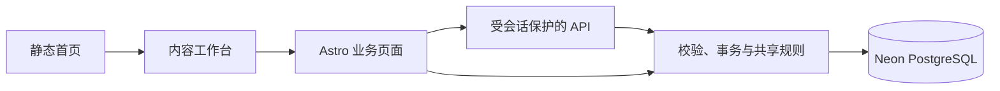

# 架构与代码索引

从功能定位入口，再阅读目标目录 README 和实现。这里维护代码关系，业务口径见 [已确认决定](DECISIONS.md)，字段见 [数据模型](data-model/DATA-MODEL.md)。

## 功能定位

| 功能 | 页面入口 | 主要规则与接口 |
| --- | --- | --- |
| 总枢纽首页 | `src/pages/index.astro` | `src/data/home.ts`、`ContentTunnel`、`src/scripts/home-motion.ts`；浅弧与平带连续循环，后两区采用紧凑阅读布局 |
| 年度规划 | `src/pages/business/annual-plan.astro` | `src/db/annual-plan*`、`api/operations-annual-plans*` |
| 排期与版本 | `src/pages/business/operations-schedule.astro` | `src/db/validation.ts`、`api/operations-content*` |
| 延期与改期审批 | 排期 Inspector | `schedule-rules.mjs`、`schedule-workflow.ts`、`schedule-delay-cleanup.ts`、改期与逐日理由接口 |
| 统一发布与分享文案 | 排期发布 Sheet 与 Inspector | `publication-workflow.ts`、`publication-link.mjs`、`publication-rules.mjs` 与 `publication` 接口 |
| 推广日度与历史 | `src/pages/business/daily-promotion-review.astro` | `promotion-rules.mjs`、`promotion-state.mjs`、`api/promotion-daily*` |
| 推广日期行 | 每帖未完成日期与今天预览 | `promotion-review-days.ts`、`BusinessPromotionDailyPosts.astro`、`BusinessPromotionMetricForm.astro` |
| 非推广复盘 | `src/pages/business/non-promotion-review.astro` | `stage-review-*`、`non-promotion-workflow.ts`、复盘与节点接口 |
| 周度例会 | `src/pages/business/meeting-review.astro` | `meeting-review-rules.mjs`、`api/meeting-reviews*` |
| 账号权限与全站字典 | `src/pages/business/settings.astro`、`annual-plan.astro` | `taxonomy-store.ts`、`api/taxonomy.ts`、`api/business-settings/` |
| 登录与权限 | `src/pages/login.astro` | `src/auth/`、`src/middleware.ts` |

## 页面与业务边界

- `src/pages/` 组装页面和 HTTP 入口，业务页不静态生成。该目录不放 README，避免 Astro 生成公开路由。
- `src/components/` 保存共享壳层、工具栏、Inspector 辅助组件；页面不复制侧栏结构和样式。
- `src/scripts/` 保存需要打包的浏览器交互；非推广交互也由此目录打包，不在 `public/` 另放一份控制器。
- `src/db/` 保存 schema、连接、服务端事务和可共享纯规则。浏览器只能导入纯规则，不能导入数据库或密钥。
- `src/auth/` 负责账号、数据库会话与角色，API 不接受浏览器传入的角色作为权限依据。

## 关键数据流

1. 新做帖建立帖子身份、V0 和排期；改帖派生 V1+，共用逻辑帖子笔记 ID。
2. 发布登记原子保存项目文档、提取后的帖子链接、发布时间和已到期的逐日理由，允许未来时间并立即显示已发送。旧记录空链接遵循既定边界；改期和已有发布时间更正按账号的操作授权执行，更正必须填写原因。
3. 推广按日度事实与明确等待区间回放。排期、历史和待办共用有效状态推导；旧团队暂停区间保留在历史回放中，单帖当前安排独立处理。
4. 非推广复盘保存真实数据截止日、两项指标与修订版本；跳过单独保存事件，不生成指标。
5. 周会引用业务事实并保存不可变定稿快照，修订追加版本；历史导入不覆盖旧定稿。

## 运行与维护

本地 Node adapter、公网 Vercel adapter 由 `astro.config.mjs` 选择。数据库连接来自私有环境变量；本地与公网共享选定分支，测试使用隔离库。

- [源码目录](../src/README.md)
- [维护工具](../scripts/README.md)
- [验证](../tests/README.md)
- [部署](deployment.md)

## 推广阶段与例会入口

- `/business/daily-promotion-review`：每日与历史共用顶栏。`?view=stage` 无快照时带日期转入周例会；已有 review／snapshot 只读，聚合与保存接口保留旧业务兼容。
- `src/db/promotion-wait-ranges.ts` 与 `/api/promotion-wait-ranges`：逐帖区间、次日动作和历史保护；每日和历史的状态入口由 `BusinessPromotionTimeline` 按场景呈现，共用原读写与回放规则。共用时序推导在 `promotion-rules.mjs` 与 `promotion-state.mjs`。
- `src/db/meeting-snapshots.ts` 保留 v2/v3 校验装配；`meeting-weekly-material.ts` 生成 v4 周／月例会候选、区间总量、本帖历史／历史同类与来源指纹，`BusinessWeeklyMeeting`／`WeeklyReviewCards` 承载编辑，`BusinessWeeklySnapshot` 按结果／核心结论优先的阅读层级显示冻结结果，草稿填写顺序保留。`GET /api/meeting-reviews/:id/material` 显式刷新，PATCH 保存／定稿只接收选择与人工内容；图片继续走认证接口。
- `meeting-finalization.ts` 共用会前／会后缺项规则；编辑器先提示并定位，事务内再次核对。来源冲突定位刷新入口，失败保留输入且支持重试；已确认非推广的隐藏字段禁用，不参与整表原生校验。
- `meeting-card-rules.ts` 共用非零事实区间、点击率区间复核、非推广排序、自动标题及半填写事项判断。材料只新增展示区间和冻结当日状态映射，不改原事实；编辑器刷新和保存事务均核对点击率区间，确认后绑定新区间。标准格式的自动标题随成功读取的区间预览，兼容旧草稿标题未同步的情况；自定义名称保留，刷新失败不改名，持久化与区间同事务。

## 共享界面接入

前端任务每次按此顺序接手：读 [DESIGN](DESIGN.md) → 检查下列真实例子和共享代码 → 通过 Props、插槽或业务适配器接入 → 执行[界面验收](../tests/README.md#界面一致性验收)。规则以 DESIGN 为准，此处只维护可直接定位的实例。

| 场景 | 真实实现 | 修改入口 |
| --- | --- | --- |
| 应用壳层与正文留白 | [Frame](../src/components/BusinessConsoleFrame.astro)、[排期](../src/pages/business/operations-schedule.astro) | `main.business-console-content` 使用 Frame 变量，业务样式只作用于正文内部；横向裁切使用 clip，避免创建滚动祖先导致覆盖详情打开后工具栏失去吸顶 |
| 公共标题和视角切换 | [Toolbar](../src/components/BusinessConsoleToolbar.astro)、[推广顶栏](../src/components/BusinessPromotionToolbar.astro) | 命名插槽组合控件；推广 `transition:persist` 保留顶栏及按钮，切换后同步激活态 |
| 已加载详情模板 | [非推广](../src/pages/business/non-promotion-review.astro)、[推广每日与历史](../src/pages/business/daily-promotion-review.astro) | 行 `data-inspector-key`，行内标题／动作按钮加 `data-inspector-trigger`（不重复行键），惰性 `template[data-inspector-template]`，`BusinessInspector parameter="row" templates`；公共控制器在稳定父容器委托事件，本帖局部刷新后仍可打开详情；阅读详情不触发外部草稿离开确认，清理面板时保留其他表单的未保存保护 |
| 业务对象填充面板 | [年度适配器](../src/scripts/annual-plan.ts)、[排期](../src/pages/business/operations-schedule.astro) | `getInspector(element,{render,select})`；排期内联适配器通过 `business:inspector-select` / `business:inspector-render-record` 通信 |
| 统一详情开关 | [Inspector 组件](../src/components/BusinessInspector.astro)、[控制器](../src/scripts/business-inspector.ts) | 几何、单一正文滚动、固定头尾、焦点、历史、dirty、移动端和动效在公共实现修改；静态内容和惰性模板由控制器统一收纳到 `data-inspector-body` |
| 保存与重新读取 | [非推广适配器](../src/scripts/non-promotion-review.ts)、[读取模型](../src/db/non-promotion-read-model.ts) | POST 成功后 `setClean()`，GET 同一读模型刷新行、模板及轮次基准；失败保留输入 |
| 原位分组与查询参数 | [非推广适配器](../src/scripts/non-promotion-review.ts)、[共享 Inspector](../src/scripts/business-inspector.ts) | 分类均值六列单层表头、同类两轮上下排列，`data-category-records` 在所属分类下接收同一批真实记录节点，平铺移回 `data-review-body`，展开不导航；`localParameters`、`setLocalParameter` 与 `onContextChange` 同步 URL 和前后退，保留详情及 dirty 输入 |
| 筛选与展示方式 | [非推广页面](../src/pages/business/non-promotion-review.astro)、[ViewSwitch](../src/components/BusinessViewSwitch.astro) | 条件表单与展示操作分组；单选切换只更新已登记的局部参数，不提交筛选或重建表格 |
| 编辑与发布抽屉 | [FormSheet](../src/components/BusinessFormSheet.astro)、[排期页面](../src/pages/business/operations-schedule.astro) | 插槽内保留原表单与字段，使用 `dialog-head / sheet-body / dialog-actions` 三段结构；只滚动正文，字段与按钮规格由组件维护 |
| 完整日期时间拆分输入 | [DateTimeFields](../src/components/BusinessDateTimeFields.astro)、[控制器](../src/scripts/business-datetime.ts)、[排期](../src/pages/business/operations-schedule.astro) | 原生 date／time 与原时间戳隐藏字段共用；配置通过 `business:datetime-configure` 或 `configureDateTimeField`，捕获输入／提交同步，动态改期表单克隆同一模板 |
| 字体与详情操作区 | [字体基准](../src/styles/business-typography.css)、[Inspector](../src/components/BusinessInspector.astro)、[统计](../src/components/BusinessToolbarSummary.astro) | 原生控件显式字体；数字正文字体＋tabular-nums；排期／年度 footer 接入 `business-inspector-actions`，通过主要／次要动作类保持层级 |
| 常规表单与日期 | [共享表单样式](../src/styles/business-forms.css)、[设置](../src/pages/business/settings.astro)、[时间格式](../src/scripts/business-date.ts) | 在表单显式接入 `business-form`，筛选使用 `business-filter`；标签、40/36px 控件、只读和反馈由共享规则维护，不影响日历卡片或年度矩阵 |
| 居中编辑与轻量对话框 | [FormDialog](../src/components/BusinessFormDialog.astro)、[年度](../src/pages/business/annual-plan.astro)、[例会](../src/pages/business/meeting-review.astro)、[推广历史](../src/pages/business/daily-promotion-review.astro) | `dialog-head / form-dialog-body / dialog-actions` 三段，宽度按任务指定；长编辑任务使用 `data-form-editor` 保持视口内高度，沿用原 ID、字段及事件，不改变居中与侧边操作习惯 |
| 空态与动态版本历史 | [年度规划](../src/pages/business/annual-plan.astro)、[年度适配器](../src/scripts/annual-plan.ts)、[Frame](../src/components/BusinessConsoleFrame.astro) | 使用共享字体变量及中性次级按钮；动态 DOM 也命中本区块样式，时间明确按上海时区格式化 |
| 持续状态的待办表达 | [待办行](../src/components/BusinessPromotionPendingRows.astro)、[展示模型](../src/db/promotion-pending.ts)、[区域样式](../src/styles/promotion-pending.css) | 首次推广安排使用主表灰行与状态下浮层；活动内暂停／待定接入普通逐日队列，新草稿默认零、已有输入不覆盖，真实跑量计原阶段；主键为活动＋日期 |
| 录入表头与角标 | `BusinessPromotionDailyPosts.astro`、`promotion-pending.css` | 每日与残留补录共用 `.review-entry-head`，标题／单位／说明整组在列内居中；数值输入独立右对齐。例会状态用定位上标，不挤偏主文字；`data-meeting-result` 仅包裹安排纯文本，浮层读取不带星号。阅读型表格按 DESIGN 的同类规则接入，不使用全局居中覆盖 |
| 就近查看帖子资料 | `BusinessPostReferences.astro`、`WeeklyCardDetails.tsx`、`business-popover.ts` | 共享原生气泡开关／定位／键盘与视觉，消费者声明表格或卡片边界；资料只读展示版本文档、排期帖子链接和主体 ID，ID 补填仍委托本行保存。共享行为不复制业务表单 |
| 例会安排原位更正 | `BusinessPromotionMetricForm.astro`、`meeting-decision.ts`、`promotion-editor-lifecycle.ts` | 安排编辑在原行的锚定气泡完成；指标单条与批量保存先处理安排草稿，保存只更新相关行、保留指标／节点／滚动，决定 ID 与版本用于并发校验 |
| 推广状态和历史 | [状态组件](../src/components/BusinessPromotionTimeline.astro)、[适配器](../src/scripts/promotion-timeline.ts)、[事务](../src/db/promotion-timeline.ts) | 每日／历史 SSR 与排期认证片段共用；显式业务日期＋指纹＋请求键，保存只替换本篇行，保留其他输入与公共节点 |
| 申请字段对照 | [SSR 组件](../src/components/BusinessChangeDiff.astro)、[异步适配器](../src/scripts/business-change-diff.ts)、[样式](../src/styles/business-changes.css) | 每个字段纵向展示原内容与申请内容，安全文本渲染，不创建横向表格或嵌套滚动 |
| 排期申请队列 | [审核组件](../src/components/BusinessScheduleApprovals.astro)、[适配器](../src/scripts/schedule-approvals.ts)、[读模型](../src/db/schedule-approvals.ts) | 统一新旧申请，模板复用 Inspector，默认首项和 `request` 深链接；固定 footer 审核，原位更新结果与计数 |
| 读取反馈与取消 | [共享读取](../src/scripts/business-read.ts)、[排期详情](../src/scripts/operations-workflow.ts)、[年度历史](../src/scripts/annual-plan.ts)、[推广刷新](../src/scripts/promotion-timeline.ts) | `readBusiness(target, task, {isCurrent})` 包含 fetch 与解析；500ms 目标区域单反馈，同目标替换取消，落地前复核代次，关闭及导航清理 |
| 验收实例 | [界面浏览器测试](../tests/business-ui.browser.ts)、[排期工作流](../tests/schedule-workflow.browser.ts) | 隔离数据与真实 DOM，检查节点身份、坐标和交互结果 |

非推广的行、标题与末列操作共用同一排期＋轮次键；公共委托允许显式 `data-inspector-trigger` 按钮，原生键盘生成 click，关闭回到实际触发按钮。普通外链仍独立处理。资料由 `readNonPromotionReview` 同时供给 SSR 与认证 GET，包含 `projectDocUrl`、`publicationUrl`、`plannedPublishAt` 与 `actualPublishAt`；使用 `businessDateTime`，排期链接使用应发上海月份＋排期 ID，新标签保留当前草稿。实验日期在同一列以两个 `time` 显示上海实发日与共享规则返回的 `dueOn`（7／15天），排序键仍为实发日；保存和分类切换保留日期节点，不改人工填写的 `recordedThrough`。

模板中的业务表单由页面适配器代理事件；`business:inspector-render` 只初始化新挂载内容，不导航、不重建列表。需要异步补充时立即显示本地内容，在请求后比较选择和请求代次，失败在面板内提供重试；排期的 [operations-workflow](../src/scripts/operations-workflow.ts) 是完整实例。

排期 `showPanel` 读取时清空并隐藏待处理分组，收到真实待办或错误后才显现，空结果继续隐藏；历史与推广片段同样从隐藏空态开始。慢读由 Inspector 的共享500ms反馈承担，不能用空的带边框业务区代替。`test:inspector-loading` 检查快慢读取期间的实际高度、资料起点与重试、切帖、关闭清理。

新增或变更共享模式时同时修改此表及行为验收，避免示例与运行代码分离。服务端读模型只允许 SSR/API 使用；浏览器中的 `import type` 仅提供类型，不能导入连接或执行数据库查询。

局部参数只登记不改变数据集的界面状态；学科、分类仍通过原筛选读取数据，首轮、二轮始终同时保留。分组切换不提交筛选表单、不重建列表或详情模板，指标保存后的 GET 刷新继续使用同一读模型。设计文案仅说明必要业务边界，不能把接入过程或布局考虑展示给业务使用者。

发布流程写入集中在 `src/db/publication-workflow.ts`：统一登记时间和链接，使用排期行锁、发布修订号及更正审计。`publication-link.mjs` 为 SSR/API 和浏览器共用的分享文案识别；`publication-rules.mjs` 维护发布状态与旧空值边界。`operations-workflow.ts` 按待处理／历史分层核对延期理由、提供链接预览并只读展示旧预约历史。原因录入、补登、更正、历史和申请差异共用 `schedule-rules.delayResponsibilityLabels` 的“运营原因／非运营原因”；归属指运营岗位，编辑账号独立留痕。排期及旧修订保存 `delayThresholdHours`，状态、原因和更正统一使用 2 小时门槛；未登记催办与最终延期判定分开，改期审批由服务端按原记录复核。

排期页面的日历日期按钮及空白点击共用 `openForm`，仅传入预填日期；日期与时分组合成原 `plannedPublishAt` 提交，编辑、改帖沿用相同控件。月历与台账复用完成状态计算，推广身份由独立标签表示。验收见 `publication.browser.ts`。

日期格式统一入口为 `business-date.ts`，SSR 与异步回显不得再定义私有格式。面板读取采用 500ms 延迟反馈；Frame 只为写入修改触发按钮。`business-dialog.ts` 维护公共站内确认和 Sheet／Dialog 退出生命周期，删除排期、区间影响、笔记 ID、年度恢复和例会定稿／草稿删除均通过 `businessConfirm` 的标题及动作参数接入；失败由所属区域提供反馈。确认框与其他 Dialog 的 footer 共用 `business-forms.css`，原生按钮也显式使用 40px／13px 规格。Sidebar 的未保存保护交给共享导航控制器，退出成功后再清理 dirty，避免二次触发 beforeunload。业务关闭回调清理 dirty 后沿用公共 close，不直接隐藏 DOM。共享控制器也接管未定制的原生 cancel；已有未保存取消保护的容器标记 `data-dialog-cancel-managed`，由原保护完成确认后调用公共 close。

年度和排期的操作目录在 `auth/business-capabilities.ts`，服务端有效授权与审计在 `auth/business-permissions.ts`；`db/business-approvals.ts` 根据真实差异检查权限、事务预检并保存申请，批准复用原写入入口。`withDatabase` 用请求隔离的异步上下文保证业务写入与申请状态原子提交；不得以临时提升员工角色绕过校验。权限 UI 只负责入口与只读字段，不能替代服务端检查。

排期待审复用排期台账的行、日期分组和共享 Inspector，`BusinessChangeDiff` 为 SSR 差异实例；`operations-workflow.ts` 调用 `appendChangeDiff` 提供同结构异步详情，样式集中在 `business-changes.css`。列表的表格选择器必须限定在 `.table-wrap`，不得撑宽详情。`BusinessPromotionDailyPosts` 委托每日记录呈现首次灰行，`BusinessPromotionTimeline` 历史／Inspector 沿用更正表单与区间；首次资格同时核对排期原状态，历史终态没有活动明细也不能进入首次队列。

首次推广与启用前历史区间的 `.review-arrangement` 显示 `reviewOn`（区间末日次日），未到期时禁用选择与保存；隐藏提交字段 `reviewDate` 仍为区间末日，不能随展示文案一并顺延。`data-pending-editor` 沿用原 API 处理这些安排及兼容历史，不把未来截止日调整误当作实际投放。当前活动内暂停／待定使用逐日 `BusinessPromotionMetricForm`，不套用区间截止日表单；`test:timeline` 与 `test:review-workbench` 分别覆盖首次／历史兼容和当前逐日行为。

`promotion-review-days.ts` 把数据日期、是否到开放时刻、是否被前日阻挡分别计算；`BusinessPromotionDailyPosts` 按可填、待开放与前日未完成归组，`BusinessPromotionMetricForm` 复用草稿、当日状态和成本控制器。`promotion-review-days.ts` 浏览器适配器按服务端上海时间在午夜及返回时重读，原位刷新、保留草稿和展开；今天预览不提供指标提交，日度写入仍由原 API 校验 T+1。`test:review-workbench` 使用隔离服务端时钟与浏览器时钟一起跨越午夜，不能只修改前端按钮验证开放。

面板动效统一由 `business-inspector.ts` 与 `business-dialog.ts` 管理。排期正文使用 `data-inspector-host` 接入共享轨道；Inspector 在实际退出动画结束前保留 `.is-open`，同时收拢停靠轨道和间距，内容保持固定宽度。Sheet／Dialog 等待面板和 `::backdrop` 都退出再调用原生关闭，快速重开废弃旧退出任务。两类容器通过 `setBusinessScrollLock` 共享嵌套锁与滚动恢复，Frame 保留滚动条槽位。不要在页面添加关闭定时器、移除节点或重复锁定；逐帧验收入口为 `pnpm test:motion`。

推广概览由 `promotion-overview.ts` 从原阶段与日度事实计算阶段节点、已登记天数和日期，`BusinessPromotionSummary` 与每日表格、Inspector 共用于每日及历史。`promotion-disclosure.ts` 负责日期行、分类明细和数据表的成对展开；`business-data-motion.ts` 只在真实进入时播放节点，局部保存只强调真正改变的阶段。团队暂停新建／修改接口已停用，共用上下文和锁保留，历史批次通过退役迁移结束有效期而不删事实。

`promotion-audit-view.ts` 只读分类首次安排、业务更正、技术维护及未确认类别，并把快照翻译成明确前后状态；`BusinessPromotionTimeline` 在推广与排期 Inspector 共用此过滤，底层审计不删改。已知技术记录不进入业务历史，新增未知技术类别先询问用户。单日详情只接入当日事件，整篇入口查看全部业务历史；无业务记录不显示空入口。

公共离开保护把 Inspector 选择参数作为本地历史处理，页面其他草稿保留；面板自己的未保存修改继续确认。表格或分区收起后关闭 Inspector，焦点回到所属展开入口。

旧待定初始化使用迁移中原有的扁平日期字段，只表达真实的首次待定安排；旧记录没有逐次操作时间，不能把待定截止日误写成操作日，也不生成相同前后值的假更正。

移动端 Inspector 的焦点范围包含原生 `summary`，排除折叠内容中的字段；Chrome 的关闭 `details` 仍可能保留布局盒，不能只用 `getClientRects()` 判断键盘可达性。

每日表单由 `promotion-daily-form.ts` 管理原行草稿、校验、计算与保存锁；`BusinessPostReferences` 仅展示资料，复用 `business-popover.ts` 与例会相同的原生气泡行为。版本行复用 `promotion-pending.css` 的18px行框和4px间距，资料按钮用伪元素扩展至24px点击区域，避免组件外边距与行内gap叠加。表格不再克隆到 Inspector；查看资料不导航或触发草稿确认，缺失 ID 的确认仍只更新本地草稿并随复盘原子保存。

推广精确状态和后继选择共用 `promotion-successors.mjs`；`promotionDayStatusEdit` 排除该日已有覆盖后回放原状态，SSR 和事务共用更正选项，误选终态可恢复该日原状态且不开放历史终态之后重启。状态气泡只传行日期、目标状态与原因，保存后仍显示“修改”，次日安排独立；终态与进行中互改时原位恢复相应选择控件，保留数字草稿。`promotion-residual.ts` 复用日度 API 的笔记搜索／残留保存；服务端稳定归属由日度事实的 `sourceStageStartedOn` 及阶段聚合维护，不以临时阶段行 ID 关联。

### 每日轻量补 ID 与批量复盘

`promotion-daily-write.ts` 复用原单条事务写入；`api/promotion-daily/batch.ts` 先校验事务初始指纹、内容 ID 一致性，再按稳定顺序写入，任何一行失败整批回滚。浏览器只捕获当前 ready 队列，按活动与日期去重，成功用同一服务端文档按 schedule 合并，不替换其他输入节点。

### 周例会卡片与读取反馈

周例会 React 岛复用 Frame、Toolbar、BusinessDateTimeFields、表单变量与 `businessConfirm`；异步候选调用公共 `readBusiness`，保留当前人工输入和勾选，区间变动使旧响应失效。条件筛选仅设置卡片 hidden，完整事实／比较来源由服务端保存到 v4 JSON，不增加表结构。新模式用 `tests/meeting-weekly.browser.ts` 验证正式组件和隔离业务数据，旧 v2/v3 与旧阶段只读兼容继续由 `test:reviews` 验证。

例会内联模式：`WeeklyReviewCards` 在卡片确认／修改，`BusinessWeeklyMeeting` 保存未确认草稿并使用公共读取与确认反馈；CSS Grid 保持同组同行卡片等高。`PATCH /api/meeting-reviews/:id` 的 `finalize_version_draft` 的 pre／post 分别冻结材料和发布次日决定，`meeting-decisions.ts` 按生效日合并不可变版本；`promotion-review-days.ts` 将决定接入每日表单，`meeting-decision.ts` 只在填写理由后更正并保留数字输入。`tests/meeting-inline.browser.ts` 验证正式组件、跨日、内联草稿与锁定，`meeting-decisions.test.ts` 验证版本优先级及终态日期。

例会明细使用 `WeeklyCardDetails`＋`meeting-layout` 的原生非模态 popover，编辑与无 hydration 的冻结卡共用；触发按钮留在原位，不测全页卡高。Toolbar 的 `layout="title"` 为没有居中控件的对象页保留完整标题宽度，不改变公共高度。`meeting-note-ids` 通过 SSR 与 material GET 的独立 `noteIds` 返回实时主体 ID，不进入材料、指纹或新冻结快照。

`readWeeklyDraftStates` 仅用于可编辑例会的 SSR 与草稿保存兼容，缺状态时才批量读取推广上下文，按活动＋日期查真实日度并回放；只增加缺失的 `dailyStates`，不改 facts／总计／指纹和人工值。无对应记录不回填，冻结视图不调用；新材料仍由 `readWeeklyMaterial` 完整生成。

最新延期计算仅接收当前排期；改期与实发更正共用 `pruneScheduleDelayReasons`，在原事务锁内删除失效原因及审批／推广快照中的结构化副本。旧排期提交被拒绝，审批快照只读取当前修订；请求清理按 Content-Type 解析，兼容 multipart。改期理由和其他业务事实保留，不能整条删除审计或改写自由文字。

例会非推广的日期使用共享 `checkpointsForPublishDate`，待填与二轮前置首轮均取各自到期日，不使用会议结束日。`meeting-non-promotion.ts` 同供浏览器与事务确定本期必纳入引用；服务端仍检查全部 pending。`readWeeklyPostDetails` 在 SSR／材料刷新中批量读取推广、非推广与待处理节点的笔记 ID 与当前资料，和指标指纹分开；冻结视图只读获取当前链接，不回写快照。`WeeklyCardDetails variant="info"` 由两类卡片共用标题文字后的资料气泡，底部明细保留原触发方式，定位、悬停／聚焦、点击保持与关闭统一由 `meeting-layout` 管理。

规划内联字典接入：`annual-plan.astro` 的 `taxonomy-field` 在字段下展开，`annual-plan.ts` 调用管理员 `/api/taxonomy`，以 `taxonomy-store.ts` 统一追加、重名复用及学科关联。排期校验、复盘筛选与审批名称从数据库字典读取，`taxonomy.ts` 仅供初始化及旧纯规则测试。`settings-taxonomy-retest.browser.ts` 验证输入保留、失败重试、全站可用与权限。

规划共享校验将已合并的旧讲义分类编号归一到现有“非推广讲义帖”；旧页面提交、历史恢复及审核重放复用该入口，保留原快照JSON。`annual-plan.browser.ts` 实际恢复旧分类快照并核对当前关联及原版本不变。

推广轮次由 `promotion-cycles.mjs` 从已确认复测动作计算，日度以 `sourceStageStartedOn` 记录所属轮次；`promotion-replay.mjs` 分离复测动作与实际状态。例会决定保留可选action，不能把复测压成普通testing；`settings-taxonomy-retest.test.ts` 与浏览器专项覆盖100/30、暂停恢复、次日生效、同日去重及冻结版本。

`WeeklyMeetingPresentation` 共用会前／会后阅读、最新版本编辑与打印布局。`BusinessMeetingDiscussion` 监听公共 `BusinessViewSwitch`，默认只读，保存 `save_version_draft` 首次建立下一版草稿，重复保存更新同一行；`finalize_version_draft` 按 pre／post 在同一行定稿。`meeting-version-workflow` 事务锁定来源版本与更新时间，合并白名单、固定生效日、记录事项前后值；`rollback_version` 仅生效日前确认回溯，保留失效版本并创建待重新定稿的会前恢复版本。`meeting-decision-rules` 跳过失效版本与纯文字继承事件，防止重复执行或盖掉日度更正。

`meeting-rate-comparison.withFrozenRateComparisons` 只从旧定稿自身材料补齐缺失比较信息，页面和PDF共用，不查询实时指标或写快照。卡片显示pp和一处样本数。

`meeting-pdf-render.tsx` 将同一React展示组件、共享视觉变量、打印样式及MiSans内联，以本地serverless Chromium打印A4横向三列。禁止外网请求，不复制登录会话；`meeting-pdf` 按内容／模板指纹和版本租约生成，成功替换旧自动文件，独立上传保留。`MeetingPdfArchive` 仅在总览和折叠历史中提供操作。`tests/meeting-discussion.browser.ts` 与 `meeting-version-workflow.test.ts` 覆盖新模式、冻结、期限、回溯和打印流程。

版本草稿接入：`lifecycleStatus` 与 `finalizationStage` 分别表达是否定稿、会前／会后，`activeMeetingDraft` 选择续填入口，`currentVersionNumber` 仍指最新有效定稿。初始编辑器通过 `WeeklyMeetingPresentation` 的卡片插槽复用正文与事项表；修订只合并白名单。草稿不参与均值、决定或 PDF；回溯的撤销日志独立保存，不能依赖可编辑快照执行。`meeting-draft-migration.test.ts` 覆盖兼容迁移；编辑表格测真实控件中线，率与 pp 测同行和溢出，四档截图仍需人工审阅。

`meeting-discussion-values.meetingDiscussionKey` 在浏览器及修订事务共用实际值比较，忽略空占位、对象键序与首尾空格；打开编辑器不置脏，改回原值取消未保存状态。初次建修订草稿及每次定稿接入 `businessConfirm`，同版草稿正常保存；事务拒绝空修订，允许现存草稿同号定稿及会前转会后维持原方案。待确认草稿的安排优先于执行快照，避免重开时被旧决定覆盖。

### 数据区块操作与首次安排接入

`BusinessSectionHeader` 的 end 插槽可以是只读统计，也可以接 `<BusinessToolbarActions slot="end" variant="section">`。区块主按钮使用 `primary-action`，轻量按钮和链接无额外 margin；标题、计数、图标和状态变化均验收真实文字中线与可见12px间距。历史筛选的查看／重置共用同一操作组，年度新建的文字与加号由父级 gap 管理。顶部已有消费者省略 variant，保留8px间距及原样式，不将只读统计换成按钮。

每日 `BusinessPromotionDailyPosts` 用 `promotionReviewQueue.main` 在同一 `review-entry-scroll` 内渲染可填指标和 `BusinessPromotionInitialRow`；`ready` 与 dueCount 继续只统计指标。初始灰行没有 `data-metric-form`，禁用框无提交名称，不伪造零。状态浮层复用 timeline 保存、公共确认与 promotion editor 生命周期；后者独立于右侧 plan 表单。保存成功通过 `business:operation-receipt` 复用公共通知外壳；即使该行进入待开放队列也可见，不增加一行反馈占位。排期／历史的 `BusinessPromotionPendingRows` 保留自身布局，不复制主表DOM；历史日期与选择按160px可读字段组换行，明确覆盖公共表单的 min-width:0，不能只检查无溢出而保留被裁切的日期。

新首次待定用显式 null，省略字段保留旧接口语义。只读模型区分尚未安排与计划已存但截止为空，T+1按业务日期推导，不能按点击日重写草稿日期。局部刷新保留稳定记录键、其他指标节点、焦点及滚动。验收覆盖工具栏所有保存状态、五档视口、灰行与真实零值混排、有限／无截止、失败重试、关闭／导航／跨午夜草稿保护；实际查看图像和录像后才能计为通过。

共享数据界面的条件态接入：`BusinessPromotionInitialRow` 的下一步日期仍属于原 plan 表单，只通过 `data-deadline-panel` 原生手动气泡查看／编辑，不嵌套表单、不增第二次保存；控制器负责开关、焦点、视口定位，关闭不清空字段，取消才重置该行。`promotion-timeline` 继续负责唯一写入及空截止语义。日期气泡、取消及出错都必须与默认态对照实测，字体与尺寸要在公共 business-form 样式生效后读取。

排期普通／审批台账共用语义列锚点，资料链接通过自身位置居中，不能只改td文本对齐。移动台账保留卡片布局，时间按完整时分和实发说明分配72px，版本按三字工作类型及内距分配48px，显式覆盖桌面内距；名称与状态共用左锚点，不照搬桌面短状态居中。非推广整行表头及排序继承同一字号，样本／动作按实际内容最小宽度分列；推广只读阶段列容纳最长状态，例会PDF动作允许本列内换行、错误独立整行；手动附件复用 business-popover 的顶层气泡及视口避让，避免被横滚容器裁切。权限表分别声明列宽、表头与行标题，不给所有th套同一宽度。审批差异表保留字段与前后值的可读最小列宽，窄屏横滚，不把长字段名挤成一字一行。排期统计条按标签、数字和内距的实际内容确定卡片最小宽度，空间不足内部横滚，不截断标签或将四字名称拆行。年度矩阵及月历保留自身结构，按名称、日期、状态的语义规格验收。

### 协作与来源准备接入

- `BusinessConsoleFrame` 统一接入查帖、协作脚本和协作样式。编辑容器用 `data-collaboration-resource` 声明对象、`data-collaboration-label` 声明业务名称；共享脚本负责聚焦取锁、续期、请求租约及释放，不复制页面专用轮询。
- `collaboration-resources.ts` 的写入目标映射由浏览器和服务端共用，`collaboration.ts` 把活动、指标、内容版本等映射到稳定排期身份；服务端在写事务内验证租约，原业务版本检查继续保留。新增写入口同步检查映射及实际表单聚焦状态。
- `meeting-readiness.ts` 共用例会缺项口径，`promotion-review-required.ts` 共用日度应填日期；例会仅引用 `non-promotion-record.ts` 指纹对应的正式事实。准备区只提供原入口链接，不能重新复制指标表单。
- `BusinessPostLookup` 与 `post-lookup.ts` 只读查帖；动态生成的结果使用专用全局样式，避免 Astro 作用域属性缺失导致后加载节点无样式。
