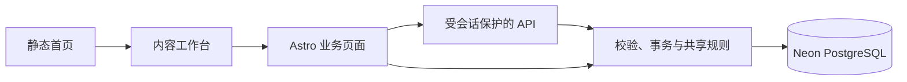

# 架构与代码索引

从功能定位入口，再阅读目标目录 README 和实现。这里维护代码关系，业务口径见 [已确认决定](DECISIONS.md)，字段见 [数据模型](data-model/DATA-MODEL.md)。

## 功能定位

| 功能 | 页面入口 | 主要规则与接口 |
| --- | --- | --- |
| 总枢纽首页 | `src/pages/index.astro` | `src/data/home.ts`、`ContentTunnel` 组件 |
| 年度规划 | `src/pages/business/annual-plan.astro` | `src/db/annual-plan*`、`api/operations-annual-plans*` |
| 排期与版本 | `src/pages/business/operations-schedule.astro` | `src/db/validation.ts`、`api/operations-content*` |
| 延期与改期审批 | 排期 Inspector | `schedule-rules.mjs`、`schedule-workflow.ts`、改期与逐日理由接口 |
| 统一发布与分享文案 | 排期发布 Sheet 与 Inspector | `publication-workflow.ts`、`publication-link.mjs`、`publication-rules.mjs` 与 `publication` 接口 |
| 推广日度与历史 | `src/pages/business/daily-promotion-review.astro` | `promotion-rules.mjs`、`promotion-state.mjs`、`api/promotion-daily*` |
| 推广日期行 | 每帖未完成日期与今天预览 | `promotion-review-days.ts`、`BusinessPromotionDailyPosts.astro`、`BusinessPromotionMetricForm.astro` |
| 非推广复盘 | `src/pages/business/non-promotion-review.astro` | `stage-review-*`、`non-promotion-workflow.ts`、复盘与节点接口 |
| 周度例会 | `src/pages/business/meeting-review.astro` | `meeting-review-rules.mjs`、`api/meeting-reviews*` |
| 全局分类规则 | `src/pages/business/settings.astro` | `taxonomy.ts`、`api/business-settings/` |
| 登录与权限 | `src/pages/login.astro` | `src/auth/`、`src/middleware.ts` |

## 页面与业务边界

- `src/pages/` 组装页面和 HTTP 入口，业务页不静态生成。该目录不放 README，避免 Astro 生成公开路由。
- `src/components/` 保存共享壳层、工具栏、Inspector 辅助组件；页面不复制侧栏结构和样式。
- `src/scripts/` 保存需要打包的浏览器交互；非推广交互也由此目录打包，不在 `public/` 另放一份控制器。
- `src/db/` 保存 schema、连接、服务端事务和可共享纯规则。浏览器只能导入纯规则，不能导入数据库或密钥。
- `src/auth/` 负责账号、数据库会话与角色，API 不接受浏览器传入的角色作为权限依据。

## 关键数据流

1. 新做帖建立帖子身份、V0 和排期；改帖派生 V1+，共用逻辑帖子笔记 ID。
2. 发布登记原子保存项目文档、提取后的帖子链接、发布时间和已到期的逐日理由，允许未来时间并立即显示已发送。旧记录空链接遵循既定边界；改期和已有发布时间更正按账号的操作授权执行，更正必须填写原因。
3. 推广按日度事实与明确等待区间回放。排期、历史和待办共用有效状态推导；旧团队暂停区间保留在历史回放中，单帖当前安排独立处理。
4. 非推广复盘保存真实数据截止日、两项指标与修订版本；跳过单独保存事件，不生成指标。
5. 周会引用业务事实并保存不可变定稿快照，修订追加版本；历史导入不覆盖旧定稿。

## 运行与维护

本地 Node adapter、公网 Vercel adapter 由 `astro.config.mjs` 选择。数据库连接来自私有环境变量；本地与公网共享选定分支，测试使用隔离库。

- [源码目录](../src/README.md)
- [维护工具](../scripts/README.md)
- [验证](../tests/README.md)
- [部署](deployment.md)

## 推广阶段与例会入口

- `/business/daily-promotion-review?view=stage`：自选日期、预览及 V0/V1+ 快照；聚合与存储在 `src/db/promotion-stage-reviews.ts`，接口为 `/api/promotion-stage-reviews`。旧 `/api/stage-reviews` 继续作为例会兼容入口。
- `src/db/promotion-wait-ranges.ts` 与 `/api/promotion-wait-ranges`：逐帖区间、次日动作和历史保护；每日和历史的状态入口由 `BusinessPromotionTimeline` 按场景呈现，共用原读写与回放规则。共用时序推导在 `promotion-rules.mjs` 与 `promotion-state.mjs`。
- `src/db/meeting-snapshots.ts`：例会草稿校验和服务端生成的引用事实；`BusinessMeetingSnapshot` 展示冻结版本。`/api/meeting-attachments` 负责登录保护的图片上传和读取。

## 共享界面接入

前端任务每次按此顺序接手：读 [DESIGN](DESIGN.md) → 检查下列真实例子和共享代码 → 通过 Props、插槽或业务适配器接入 → 执行[界面验收](../tests/README.md#界面一致性验收)。规则以 DESIGN 为准，此处只维护可直接定位的实例。

| 场景 | 真实实现 | 修改入口 |
| --- | --- | --- |
| 应用壳层与正文留白 | [Frame](../src/components/BusinessConsoleFrame.astro)、[排期](../src/pages/business/operations-schedule.astro) | `main.business-console-content` 使用 Frame 变量，业务样式只作用于正文内部 |
| 公共标题和视角切换 | [Toolbar](../src/components/BusinessConsoleToolbar.astro)、[推广顶栏](../src/components/BusinessPromotionToolbar.astro) | 命名插槽组合控件；推广 `transition:persist` 保留顶栏及按钮，切换后同步激活态 |
| 已加载详情模板 | [非推广](../src/pages/business/non-promotion-review.astro)、[推广每日与历史](../src/pages/business/daily-promotion-review.astro) | 行 `data-inspector-key`，惰性 `template[data-inspector-template]`，`BusinessInspector parameter="row" templates`；公共控制器在稳定父容器委托事件，本帖局部刷新后仍可打开详情；阅读详情不触发外部草稿离开确认，清理面板时保留其他表单的未保存保护 |
| 业务对象填充面板 | [年度适配器](../src/scripts/annual-plan.ts)、[排期](../src/pages/business/operations-schedule.astro) | `getInspector(element,{render,select})`；排期内联适配器通过 `business:inspector-select` / `business:inspector-render-record` 通信 |
| 统一详情开关 | [Inspector 组件](../src/components/BusinessInspector.astro)、[控制器](../src/scripts/business-inspector.ts) | 几何、单一正文滚动、固定头尾、焦点、历史、dirty、移动端和动效在公共实现修改；静态内容和惰性模板由控制器统一收纳到 `data-inspector-body` |
| 保存与重新读取 | [非推广适配器](../src/scripts/non-promotion-review.ts)、[读取模型](../src/db/non-promotion-read-model.ts) | POST 成功后 `setClean()`，GET 同一读模型刷新行、模板及轮次基准；失败保留输入 |
| 原位分组与查询参数 | [非推广适配器](../src/scripts/non-promotion-review.ts)、[共享 Inspector](../src/scripts/business-inspector.ts) | 分类均值六列单层表头、同类两轮上下排列，`data-category-records` 在所属分类下接收同一批真实记录节点，平铺移回 `data-review-body`，展开不导航；`localParameters`、`setLocalParameter` 与 `onContextChange` 同步 URL 和前后退，保留详情及 dirty 输入 |
| 筛选与展示方式 | [非推广页面](../src/pages/business/non-promotion-review.astro)、[ViewSwitch](../src/components/BusinessViewSwitch.astro) | 条件表单与展示操作分组；单选切换只更新已登记的局部参数，不提交筛选或重建表格 |
| 编辑与发布抽屉 | [FormSheet](../src/components/BusinessFormSheet.astro)、[排期页面](../src/pages/business/operations-schedule.astro) | 插槽内保留原表单与字段，使用 `dialog-head / sheet-body / dialog-actions` 三段结构；只滚动正文，字段与按钮规格由组件维护 |
| 完整日期时间拆分输入 | [DateTimeFields](../src/components/BusinessDateTimeFields.astro)、[控制器](../src/scripts/business-datetime.ts)、[排期](../src/pages/business/operations-schedule.astro) | 原生 date／time 与原时间戳隐藏字段共用；配置通过 `business:datetime-configure` 或 `configureDateTimeField`，捕获输入／提交同步，动态改期表单克隆同一模板 |
| 字体与详情操作区 | [字体基准](../src/styles/business-typography.css)、[Inspector](../src/components/BusinessInspector.astro)、[统计](../src/components/BusinessToolbarSummary.astro) | 原生控件显式字体；数字正文字体＋tabular-nums；排期／年度 footer 接入 `business-inspector-actions`，通过主要／次要动作类保持层级 |
| 常规表单与日期 | [共享表单样式](../src/styles/business-forms.css)、[设置](../src/pages/business/settings.astro)、[时间格式](../src/scripts/business-date.ts) | 在表单显式接入 `business-form`，筛选使用 `business-filter`；标签、40/36px 控件、只读和反馈由共享规则维护，不影响日历卡片或年度矩阵 |
| 居中编辑与轻量对话框 | [FormDialog](../src/components/BusinessFormDialog.astro)、[年度](../src/pages/business/annual-plan.astro)、[例会](../src/pages/business/meeting-review.astro)、[推广历史](../src/pages/business/daily-promotion-review.astro) | `dialog-head / form-dialog-body / dialog-actions` 三段，宽度按任务指定；长编辑任务使用 `data-form-editor` 保持视口内高度，沿用原 ID、字段及事件，不改变居中与侧边操作习惯 |
| 空态与动态版本历史 | [年度规划](../src/pages/business/annual-plan.astro)、[年度适配器](../src/scripts/annual-plan.ts)、[Frame](../src/components/BusinessConsoleFrame.astro) | 使用共享字体变量及中性次级按钮；动态 DOM 也命中本区块样式，时间明确按上海时区格式化 |
| 持续状态的待办表达 | [待办行](../src/components/BusinessPromotionPendingRows.astro)、[展示模型](../src/db/promotion-pending.ts)、[区域样式](../src/styles/promotion-pending.css) | 首次推广安排保留原表单；活动内暂停／待定接入普通逐日队列，新草稿默认零、已有输入不覆盖，真实跑量计原阶段；主键为活动＋日期 |
| 推广状态和历史 | [状态组件](../src/components/BusinessPromotionTimeline.astro)、[适配器](../src/scripts/promotion-timeline.ts)、[事务](../src/db/promotion-timeline.ts) | 每日／历史 SSR 与排期认证片段共用；显式业务日期＋指纹＋请求键，保存只替换本篇行，保留其他输入与公共节点 |
| 申请字段对照 | [SSR 组件](../src/components/BusinessChangeDiff.astro)、[异步适配器](../src/scripts/business-change-diff.ts)、[样式](../src/styles/business-changes.css) | 每个字段纵向展示原内容与申请内容，安全文本渲染，不创建横向表格或嵌套滚动 |
| 排期申请队列 | [审核组件](../src/components/BusinessScheduleApprovals.astro)、[适配器](../src/scripts/schedule-approvals.ts)、[读模型](../src/db/schedule-approvals.ts) | 统一新旧申请，模板复用 Inspector，默认首项和 `request` 深链接；固定 footer 审核，原位更新结果与计数 |
| 读取反馈与取消 | [共享读取](../src/scripts/business-read.ts)、[排期详情](../src/scripts/operations-workflow.ts)、[年度历史](../src/scripts/annual-plan.ts)、[推广刷新](../src/scripts/promotion-timeline.ts) | `readBusiness(target, task, {isCurrent})` 包含 fetch 与解析；500ms 目标区域单反馈，同目标替换取消，落地前复核代次，关闭及导航清理 |
| 验收实例 | [界面浏览器测试](../tests/business-ui.browser.ts)、[排期工作流](../tests/schedule-workflow.browser.ts) | 隔离数据与真实 DOM，检查节点身份、坐标和交互结果 |

模板中的业务表单由页面适配器代理事件；`business:inspector-render` 只初始化新挂载内容，不导航、不重建列表。需要异步补充时立即显示本地内容，在请求后比较选择和请求代次，失败在面板内提供重试；排期的 [operations-workflow](../src/scripts/operations-workflow.ts) 是完整实例。

新增或变更共享模式时同时修改此表及行为验收，避免示例与运行代码分离。服务端读模型只允许 SSR/API 使用；浏览器中的 `import type` 仅提供类型，不能导入连接或执行数据库查询。

局部参数只登记不改变数据集的界面状态；学科、分类仍通过原筛选读取数据，首轮、二轮始终同时保留。分组切换不提交筛选表单、不重建列表或详情模板，指标保存后的 GET 刷新继续使用同一读模型。设计文案仅说明必要业务边界，不能把接入过程或布局考虑展示给业务使用者。

发布流程写入集中在 `src/db/publication-workflow.ts`：统一登记时间和链接，使用排期行锁、发布修订号及更正审计。`publication-link.mjs` 为 SSR/API 和浏览器共用的分享文案识别；`publication-rules.mjs` 维护发布状态与旧空值边界。`operations-workflow.ts` 按待处理／历史分层核对延期理由、提供链接预览并只读展示旧预约历史。排期及旧修订保存 `delayThresholdHours`，状态、原因和更正统一使用 2 小时门槛；未登记催办与最终延期判定分开，改期审批由服务端按原记录复核。

排期页面的日历日期按钮及空白点击共用 `openForm`，仅传入预填日期；日期与时分组合成原 `plannedPublishAt` 提交，编辑、改帖沿用相同控件。月历与台账复用完成状态计算，推广身份由独立标签表示。验收见 `publication.browser.ts`。

日期格式统一入口为 `business-date.ts`，SSR 与异步回显不得再定义私有格式。面板读取采用 500ms 延迟反馈；Frame 只为写入修改触发按钮。`business-dialog.ts` 维护公共站内确认和 Sheet／Dialog 退出生命周期，删除排期、区间影响、笔记 ID、年度恢复和例会定稿／草稿删除均通过 `businessConfirm` 的标题及动作参数接入；失败由所属区域提供反馈。确认框与其他 Dialog 的 footer 共用 `business-forms.css`，原生按钮也显式使用 40px／13px 规格。Sidebar 的未保存保护交给共享导航控制器，退出成功后再清理 dirty，避免二次触发 beforeunload。业务关闭回调清理 dirty 后沿用公共 close，不直接隐藏 DOM。共享控制器也接管未定制的原生 cancel；已有未保存取消保护的容器标记 `data-dialog-cancel-managed`，由原保护完成确认后调用公共 close。

年度和排期的操作目录在 `auth/business-capabilities.ts`，服务端有效授权与审计在 `auth/business-permissions.ts`；`db/business-approvals.ts` 根据真实差异检查权限、事务预检并保存申请，批准复用原写入入口。`withDatabase` 用请求隔离的异步上下文保证业务写入与申请状态原子提交；不得以临时提升员工角色绕过校验。权限 UI 只负责入口与只读字段，不能替代服务端检查。

排期待审复用排期台账的行、日期分组和共享 Inspector，`BusinessChangeDiff` 为 SSR 差异实例；`operations-workflow.ts` 调用 `appendChangeDiff` 提供同结构异步详情，样式集中在 `business-changes.css`。列表的表格选择器必须限定在 `.table-wrap`，不得撑宽详情。`BusinessPromotionTimeline` 每日委托待办行展示首次安排与持续区间，历史／Inspector 沿用更正表单；首次资格同时核对排期原状态，历史终态没有活动明细也不能进入首次队列。

待办行的 `.review-arrangement` 始终显示 `reviewOn`（区间末日次日），未到期时禁用选择与保存；隐藏提交字段 `reviewDate` 仍为区间末日，不能随展示文案一并顺延。`data-pending-editor` 在同一表单选择继续待定／暂停或实际开始／恢复，控制截止日期与实际日期的必填、禁用及原提交字段；沿用原 API，不把未来截止日调整误当作实际投放。标题规则在首次、持续状态和指标行共用，`promotion-pending.browser.ts` 检查真实日期、禁用、草稿及桌面同行／手机换行。

`promotion-review-days.ts` 把数据日期、是否到开放时刻、是否被前日阻挡分别计算；`BusinessPromotionDailyPosts` 保留每帖公共信息和未完成／今天日期行，`BusinessPromotionMetricForm` 复用草稿、单帖暂停和成本控制器。`promotion-review-days.ts` 浏览器适配器按服务端上海时间在午夜及返回时重读，原位刷新、保留草稿和展开；今天仅可修改安排，日度写入仍由原 API 校验 T+1。`test:review-workbench` 使用隔离服务端时钟与浏览器时钟一起跨越午夜，不能只修改前端按钮验证开放。

面板动效统一由 `business-inspector.ts` 与 `business-dialog.ts` 管理。排期正文使用 `data-inspector-host` 接入共享轨道；Inspector 在实际退出动画结束前保留 `.is-open`，同时收拢停靠轨道和间距，内容保持固定宽度。Sheet／Dialog 等待面板和 `::backdrop` 都退出再调用原生关闭，快速重开废弃旧退出任务。两类容器通过 `setBusinessScrollLock` 共享嵌套锁与滚动恢复，Frame 保留滚动条槽位。不要在页面添加关闭定时器、移除节点或重复锁定；逐帧验收入口为 `pnpm test:motion`。

推广概览由 `promotion-overview.ts` 从原阶段与日度事实计算阶段节点、已登记天数和日期，`BusinessPromotionSummary` 与每日表格、Inspector 共用于每日及历史。`promotion-disclosure.ts` 负责日期行、分类明细和数据表的成对展开；`business-data-motion.ts` 只在真实进入时播放节点，局部保存只强调真正改变的阶段。团队暂停新建／修改接口已停用，共用上下文和锁保留，历史批次通过退役迁移结束有效期而不删事实。

`promotion-audit-view.ts` 只读分类首次安排、业务更正、技术维护及未确认类别，并把快照翻译成明确前后状态；`BusinessPromotionTimeline` 在推广与排期 Inspector 共用此过滤，底层审计不删改。已知技术记录不进入业务历史，新增未知技术类别先询问用户。单日详情只接入当日事件，整篇入口查看全部业务历史；无业务记录不显示空入口。

公共离开保护把 Inspector 选择参数作为本地历史处理，页面其他草稿保留；面板自己的未保存修改继续确认。表格或分区收起后关闭 Inspector，焦点回到所属展开入口。

旧待定初始化使用迁移中原有的扁平日期字段，只表达真实的首次待定安排；旧记录没有逐次操作时间，不能把待定截止日误写成操作日，也不生成相同前后值的假更正。

移动端 Inspector 的焦点范围包含原生 `summary`，排除折叠内容中的字段；Chrome 的关闭 `details` 仍可能保留布局盒，不能只用 `getClientRects()` 判断键盘可达性。

推广待办的真实双入口实例在 `promotion-daily-form.ts`：以活动与业务日期定位草稿，录入行与 Inspector 为同一草稿的两个视图；模板提供排期资料，表单沿用原接口。公共 Inspector 的可选 `discard` 钩子恢复业务适配器的入口快照，`refresh` 只重绘干净详情；`setLocalParameters` 原子更新已注册展示参数，不制造多次浏览器历史。非推广 `group` 保留旧 0/1 兼容含义，新增 `bucket` 定位学科＋分类的明细；`non-promotion-groups.ts` 同供 SSR、保存后刷新与单元验证，不能与同轮基准样本池混用。

推广精确状态和后继选择共用 `promotion-successors.mjs`；`promotionDayStatusEdit` 排除该日已有覆盖后回放原状态，SSR 和事务共用更正选项，误选终态可恢复该日原状态且不开放历史终态之后重启。状态气泡只传行日期、目标状态与原因，保存后仍显示“修改”，次日安排独立；终态与进行中互改时原位恢复相应选择控件，保留数字草稿。`promotion-residual.ts` 复用日度 API 的笔记搜索／残留保存；服务端稳定归属由日度事实的 `sourceStageStartedOn` 及阶段聚合维护，不以临时阶段行 ID 关联。
