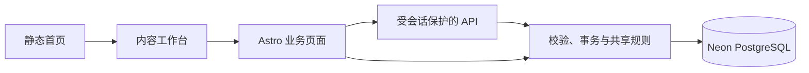

# 架构与代码索引

从功能定位入口，再阅读目标目录 README 和实现。这里维护代码关系，业务口径见 [已确认决定](DECISIONS.md)，字段见 [数据模型](data-model/DATA-MODEL.md)。

## 功能定位

| 功能 | 页面入口 | 主要规则与接口 |
| --- | --- | --- |
| 总枢纽首页 | `src/pages/index.astro` | `src/data/home.ts`、`ContentTunnel` 组件 |
| 年度规划 | `src/pages/business/annual-plan.astro` | `src/db/annual-plan*`、`api/operations-annual-plans*` |
| 排期与版本 | `src/pages/business/operations-schedule.astro` | `src/db/validation.ts`、`api/operations-content*` |
| 延期与改期审批 | 排期 Inspector | `schedule-rules.mjs`、`schedule-workflow.ts`、改期与逐日理由接口 |
| 统一发布与分享文案 | 排期发布 Sheet 与 Inspector | `publication-workflow.ts`、`publication-link.mjs`、`publication-rules.mjs` 与 `publication` 接口 |
| 推广日度与历史 | `src/pages/business/daily-promotion-review.astro` | `promotion-rules.mjs`、`promotion-state.mjs`、`api/promotion-daily*` |
| 团队节假日暂停 | 日度待办标题栏右端 | `promotion-pauses.ts`、`BusinessPromotionPause.astro`、`api/promotion-pauses*` |
| 非推广复盘 | `src/pages/business/non-promotion-review.astro` | `stage-review-*`、`non-promotion-workflow.ts`、复盘与节点接口 |
| 周度例会 | `src/pages/business/meeting-review.astro` | `meeting-review-rules.mjs`、`api/meeting-reviews*` |
| 全局分类规则 | `src/pages/business/settings.astro` | `taxonomy.ts`、`api/business-settings/` |
| 登录与权限 | `src/pages/login.astro` | `src/auth/`、`src/middleware.ts` |

## 页面与业务边界

- `src/pages/` 组装页面和 HTTP 入口，业务页不静态生成。该目录不放 README，避免 Astro 生成公开路由。
- `src/components/` 保存共享壳层、工具栏、Inspector 辅助组件；页面不复制侧栏结构和样式。
- `src/scripts/` 保存需要打包的浏览器交互；非推广交互也由此目录打包，不在 `public/` 另放一份控制器。
- `src/db/` 保存 schema、连接、服务端事务和可共享纯规则。浏览器只能导入纯规则，不能导入数据库或密钥。
- `src/auth/` 负责账号、数据库会话与角色，API 不接受浏览器传入的角色作为权限依据。

## 关键数据流

1. 新做帖建立帖子身份、V0 和排期；改帖派生 V1+，共用逻辑帖子笔记 ID。
2. 发布登记原子保存项目文档、提取后的帖子链接、发布时间和已到期的逐日理由，允许未来时间并立即显示已发送。旧记录空链接遵循既定边界；已有应发改期需审批，已有发布时间更正仅管理员并填写原因。
3. 推广按日度事实与明确等待区间回放。排期、历史和待办共用有效状态推导；节假日暂停叠加在原测试／放量阶段上，到期恢复不依赖定时任务。
4. 非推广复盘保存真实数据截止日、两项指标与修订版本；跳过单独保存事件，不生成指标。
5. 周会引用业务事实并保存不可变定稿快照，修订追加版本；历史导入不覆盖旧定稿。

## 运行与维护

本地 Node adapter、公网 Vercel adapter 由 `astro.config.mjs` 选择。数据库连接来自私有环境变量；本地与公网共享选定分支，测试使用隔离库。

- [源码目录](../src/README.md)
- [维护工具](../scripts/README.md)
- [验证](../tests/README.md)
- [部署](deployment.md)

## 推广阶段与例会入口

- `/business/daily-promotion-review?view=stage`：自选日期、预览及 V0/V1+ 快照；聚合与存储在 `src/db/promotion-stage-reviews.ts`，接口为 `/api/promotion-stage-reviews`。旧 `/api/stage-reviews` 继续作为例会兼容入口。
- `src/db/promotion-wait-ranges.ts` 与 `/api/promotion-wait-ranges`：逐帖区间、次日动作和历史保护；`BusinessPromotionWaitRanges` 同时用于每日和历史。共用时序推导在 `promotion-rules.mjs` 与 `promotion-state.mjs`。
- `src/db/meeting-snapshots.ts`：例会草稿校验和服务端生成的引用事实；`BusinessMeetingSnapshot` 展示冻结版本。`/api/meeting-attachments` 负责登录保护的图片上传和读取。

## 共享界面接入

前端任务每次按此顺序接手：读 [DESIGN](DESIGN.md) → 检查下列真实例子和共享代码 → 通过 Props、插槽或业务适配器接入 → 执行[界面验收](../tests/README.md#界面一致性验收)。规则以 DESIGN 为准，此处只维护可直接定位的实例。

| 场景 | 真实实现 | 修改入口 |
| --- | --- | --- |
| 应用壳层与正文留白 | [Frame](../src/components/BusinessConsoleFrame.astro)、[排期](../src/pages/business/operations-schedule.astro) | `main.business-console-content` 使用 Frame 变量，业务样式只作用于正文内部 |
| 公共标题和视角切换 | [Toolbar](../src/components/BusinessConsoleToolbar.astro)、[推广顶栏](../src/components/BusinessPromotionToolbar.astro) | 命名插槽组合控件；推广 `transition:persist` 保留顶栏及按钮，切换后同步激活态 |
| 已加载详情模板 | [非推广](../src/pages/business/non-promotion-review.astro)、[推广历史](../src/pages/business/daily-promotion-review.astro) | 行 `data-inspector-key`，惰性 `template[data-inspector-template]`，`BusinessInspector parameter="row" templates` |
| 业务对象填充面板 | [年度适配器](../src/scripts/annual-plan.ts)、[排期](../src/pages/business/operations-schedule.astro) | `getInspector(element,{render,select})`；排期内联适配器通过 `business:inspector-select` / `business:inspector-render-record` 通信 |
| 统一详情开关 | [Inspector 组件](../src/components/BusinessInspector.astro)、[控制器](../src/scripts/business-inspector.ts) | 几何、单一正文滚动、固定头尾、焦点、历史、dirty、移动端和动效在公共实现修改；静态内容和惰性模板由控制器统一收纳到 `data-inspector-body` |
| 保存与重新读取 | [非推广适配器](../src/scripts/non-promotion-review.ts)、[读取模型](../src/db/non-promotion-read-model.ts) | POST 成功后 `setClean()`，GET 同一读模型刷新行、模板及轮次基准；失败保留输入 |
| 原位分组与查询参数 | [非推广适配器](../src/scripts/non-promotion-review.ts)、[共享 Inspector](../src/scripts/business-inspector.ts) | 六列表头和行节点持续存在，只重排数据；`localParameters` 登记局部参数，`setLocalParameter` 与 `onContextChange` 同步 URL 和前后退，保留详情及 dirty 输入 |
| 筛选与展示方式 | [非推广页面](../src/pages/business/non-promotion-review.astro)、[ViewSwitch](../src/components/BusinessViewSwitch.astro) | 条件表单与展示操作分组；单选切换只更新已登记的局部参数，不提交筛选或重建表格 |
| 编辑与发布抽屉 | [FormSheet](../src/components/BusinessFormSheet.astro)、[排期页面](../src/pages/business/operations-schedule.astro) | 插槽内保留原表单与字段，使用 `dialog-head / sheet-body / dialog-actions` 三段结构；只滚动正文，字段与按钮规格由组件维护 |
| 完整日期时间拆分输入 | [DateTimeFields](../src/components/BusinessDateTimeFields.astro)、[控制器](../src/scripts/business-datetime.ts)、[排期](../src/pages/business/operations-schedule.astro) | 原生 date／time 与原时间戳隐藏字段共用；配置通过 `business:datetime-configure` 或 `configureDateTimeField`，捕获输入／提交同步，动态改期表单克隆同一模板 |
| 字体与详情操作区 | [字体基准](../src/styles/business-typography.css)、[Inspector](../src/components/BusinessInspector.astro)、[统计](../src/components/BusinessToolbarSummary.astro) | 原生控件显式字体；数字正文字体＋tabular-nums；排期／年度 footer 接入 `business-inspector-actions`，通过主要／次要动作类保持层级 |
| 常规表单与日期 | [共享表单样式](../src/styles/business-forms.css)、[设置](../src/pages/business/settings.astro)、[时间格式](../src/scripts/business-date.ts) | 在表单显式接入 `business-form`，筛选使用 `business-filter`；标签、40/36px 控件、只读和反馈由共享规则维护，不影响日历卡片或年度矩阵 |
| 居中编辑与轻量对话框 | [FormDialog](../src/components/BusinessFormDialog.astro)、[年度](../src/pages/business/annual-plan.astro)、[例会](../src/pages/business/meeting-review.astro)、[推广历史](../src/pages/business/daily-promotion-review.astro) | `dialog-head / form-dialog-body / dialog-actions` 三段，宽度按任务指定；长编辑任务使用 `data-form-editor` 保持视口内高度，沿用原 ID、字段及事件，不改变居中与侧边操作习惯 |
| 空态与动态版本历史 | [年度规划](../src/pages/business/annual-plan.astro)、[年度适配器](../src/scripts/annual-plan.ts)、[Frame](../src/components/BusinessConsoleFrame.astro) | 使用共享字体变量及中性次级按钮；动态 DOM 也命中本区块样式，时间明确按上海时区格式化 |
| 验收实例 | [界面浏览器测试](../tests/business-ui.browser.ts)、[排期工作流](../tests/schedule-workflow.browser.ts) | 隔离数据与真实 DOM，检查节点身份、坐标和交互结果 |

模板中的业务表单由页面适配器代理事件；`business:inspector-render` 只初始化新挂载内容，不导航、不重建列表。需要异步补充时立即显示本地内容，在请求后比较选择和请求代次，失败在面板内提供重试；排期的 [operations-workflow](../src/scripts/operations-workflow.ts) 是完整实例。

新增或变更共享模式时同时修改此表及行为验收，避免示例与运行代码分离。服务端读模型只允许 SSR/API 使用；浏览器中的 `import type` 仅提供类型，不能导入连接或执行数据库查询。

局部参数只登记不改变数据集的界面状态；学科、分类和轮次仍通过原筛选读取数据。分组切换不提交筛选表单、不重建列表或详情模板，指标保存后的 GET 刷新继续使用同一读模型。设计文案仅说明必要业务边界，不能把接入过程或布局考虑展示给业务使用者。

发布流程写入集中在 `src/db/publication-workflow.ts`：统一登记时间和链接，使用排期行锁、发布修订号及更正审计。`publication-link.mjs` 为 SSR/API 和浏览器共用的分享文案识别；`publication-rules.mjs` 维护发布状态与旧空值边界。`operations-workflow.ts` 按待处理／历史分层核对延期理由、提供链接预览并只读展示旧预约历史。排期及旧修订保存 `delayThresholdHours`，状态、原因和更正共用适用门槛；未登记催办与最终延期判定分开，改期审批由服务端按原记录复核。

排期页面的日历日期按钮及空白点击共用 `openForm`，仅传入预填日期；日期与时分组合成原 `plannedPublishAt` 提交，编辑、改帖沿用相同控件。月历与台账复用完成状态计算，推广身份由独立标签表示。验收见 `publication.browser.ts`。
