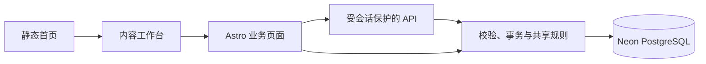

# 架构与代码索引

从功能定位入口，再阅读目标目录 README 和实现。这里维护代码关系，业务口径见 [已确认决定](DECISIONS.md)，字段见 [数据模型](data-model/DATA-MODEL.md)。

## 功能定位

| 功能 | 页面入口 | 主要规则与接口 |
| --- | --- | --- |
| 总枢纽首页 | `src/pages/index.astro` | `src/data/home.ts`、`ContentTunnel` 组件 |
| 年度规划 | `src/pages/business/annual-plan.astro` | `src/db/annual-plan*`、`api/operations-annual-plans*` |
| 排期与版本 | `src/pages/business/operations-schedule.astro` | `src/db/validation.ts`、`api/operations-content*` |
| 延期与改期审批 | 排期 Inspector | `schedule-rules.mjs`、`schedule-workflow.ts`、改期与逐日理由接口 |
| 推广日度与历史 | `src/pages/business/daily-promotion-review.astro` | `promotion-rules.mjs`、`promotion-state.mjs`、`api/promotion-daily*` |
| 团队节假日暂停 | 日度待办右侧 | `promotion-pauses.ts`、`BusinessPromotionPause.astro`、`api/promotion-pauses*` |
| 非推广复盘 | `src/pages/business/non-promotion-review.astro` | `stage-review-*`、`non-promotion-workflow.ts`、复盘与节点接口 |
| 周度例会 | `src/pages/business/meeting-review.astro` | `meeting-review-rules.mjs`、`api/meeting-reviews*` |
| 全局分类规则 | `src/pages/business/settings.astro` | `taxonomy.ts`、`api/business-settings/` |
| 登录与权限 | `src/pages/login.astro` | `src/auth/`、`src/middleware.ts` |

## 页面与业务边界

- `src/pages/` 组装页面和 HTTP 入口，业务页不静态生成。该目录不放 README，避免 Astro 生成公开路由。
- `src/components/` 保存共享壳层、工具栏、Inspector 辅助组件；页面不复制侧栏结构和样式。
- `src/scripts/` 保存需要打包的浏览器交互；`public/scripts/` 中现有非推广脚本作为公开静态资源使用。
- `src/db/` 保存 schema、连接、服务端事务和可共享纯规则。浏览器只能导入纯规则，不能导入数据库或密钥。
- `src/auth/` 负责账号、数据库会话与角色，API 不接受浏览器传入的角色作为权限依据。

## 关键数据流

1. 新做帖建立帖子身份、V0 和排期；改帖派生 V1+，共用逻辑帖子笔记 ID。
2. 实发登记保存项目链接、实发时间和逐日延期理由；员工已有应发时间的变更进入管理员审批。
3. 推广按日度事实与明确等待区间回放。排期、历史和待办共用有效状态推导；节假日暂停叠加在原测试／放量阶段上，到期恢复不依赖定时任务。
4. 非推广复盘保存真实数据截止日、两项指标与修订版本；跳过单独保存事件，不生成指标。
5. 周会引用业务事实并保存不可变定稿快照，修订追加版本；历史导入不覆盖旧定稿。

## 运行与维护

本地 Node adapter、公网 Vercel adapter 由 `astro.config.mjs` 选择。数据库连接来自私有环境变量；本地与公网共享选定分支，测试使用隔离库。

- [源码目录](../src/README.md)
- [维护工具](../scripts/README.md)
- [验证](../tests/README.md)
- [部署](deployment.md)
