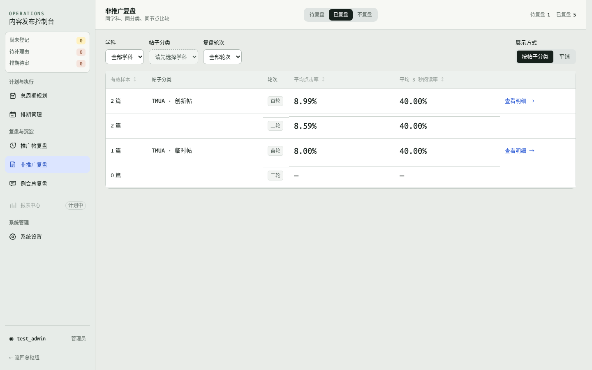
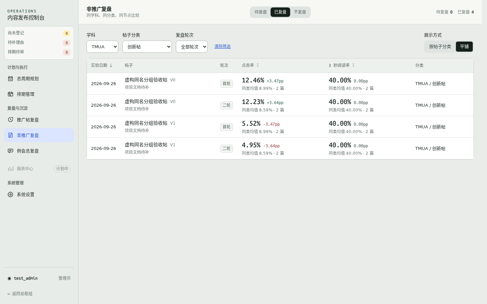

# 非推广复盘 · 分类与平铺

[返回本轮索引](../README.md)

尺寸指浏览器视口宽度；卡片和面板截图保留原始截取范围。

| 查看内容 | 桌面 1440 | 桌面 1280 | 手机 390 | 手机 320 |
| --- | --- | --- | --- | --- |
| 按帖子分类：全部分类汇总 | [查看](categories-all-desktop-1440.png) | [查看](categories-all-desktop-1280.png) | [查看](categories-all-mobile-390.png) | [查看](categories-all-mobile-320.png) |
| 按帖子分类：TMUA · 创新帖 | [查看](category-filtered-desktop-1440.png) | [查看](category-filtered-desktop-1280.png) | [查看](category-filtered-mobile-390.png) | [查看](category-filtered-mobile-320.png) |
| 进入分类：TMUA · 创新帖明细 | [查看](category-detail-desktop-1440.png) | [查看](category-detail-desktop-1280.png) | [查看](category-detail-mobile-390.png) | [查看](category-detail-mobile-320.png) |
| 平铺：TMUA · 创新帖的独立轮次 | [查看](flat-desktop-1440.png) | [查看](flat-desktop-1280.png) | [查看](flat-mobile-390.png) | [查看](flat-mobile-320.png) |

“全部分类汇总”未限定分类；其余三组均筛选 TMUA · 创新帖，可对照查看相同记录的不同展示。

以下为桌面预览，点击上表可打开原图。

