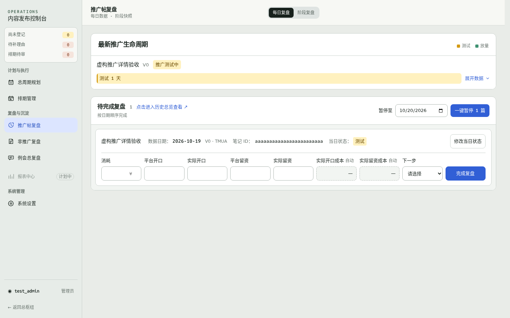

# 推广帖复盘 · 待完成复盘

[返回本轮索引](../README.md)

尺寸指浏览器视口宽度；卡片和面板截图保留原始截取范围。

| 查看内容 | 桌面 1440 | 桌面 1280 | 手机 390 | 手机 320 |
| --- | --- | --- | --- | --- |
| 页面上下文（生命周期＋待完成复盘） | [查看](page-desktop-1440.png) | [查看](page-desktop-1280.png) | [查看](page-mobile-390.png) | [查看](page-mobile-320.png) |
| 首次安排、待定／暂停与待完成复盘 | [查看](pending-states-desktop-1440.png) | [查看](pending-states-desktop-1280.png) | [查看](pending-states-mobile-390.png) | [查看](pending-states-mobile-320.png) |
| 单帖卡片：已有笔记 ID、填入长数值 | [查看](card-known-id-desktop-1440.png) | [查看](card-known-id-desktop-1280.png) | [查看](card-known-id-mobile-390.png) | [查看](card-known-id-mobile-320.png) |
| 单帖卡片：首次补填笔记 ID | [查看](card-missing-id-desktop-1440.png) | [查看](card-missing-id-desktop-1280.png) | [查看](card-missing-id-mobile-390.png) | [查看](card-missing-id-mobile-320.png) |
| 名称打开的覆盖式 Inspector | [查看](inspector-desktop-1440.png) | [查看](inspector-desktop-1280.png) | [查看](inspector-mobile-390.png) | [查看](inspector-mobile-320.png) |

补充状态：[当日暂停](paused-mobile-320.png) · [保存失败反馈](save-error-mobile-320.png)。

以下为桌面预览，点击上表可打开原图。

