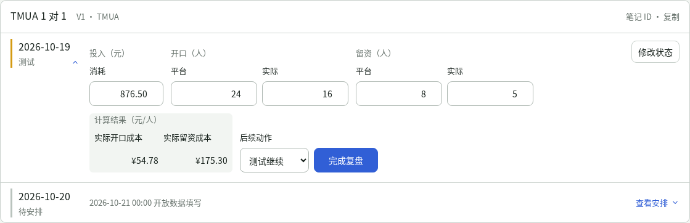
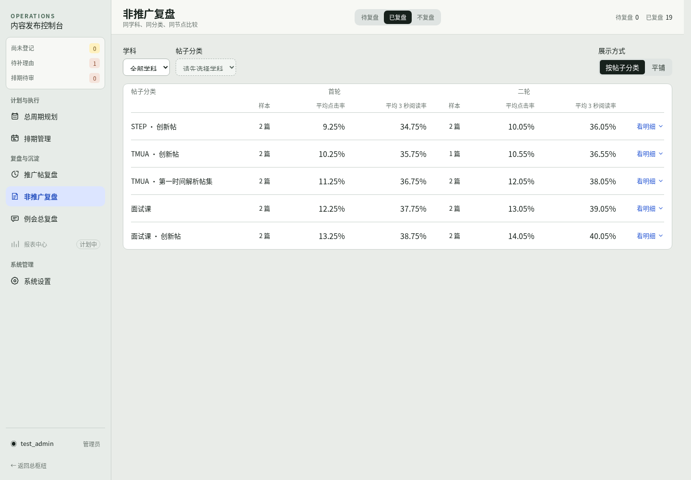

# 复盘工作台 · 2026-10-20 21:14

本轮为实际浏览器最终截图，使用隔离虚构数据。桌面检查 1280、1440、1920px；已自行检查比例、中文字体、输入宽度、日期层级、阶段节点、展开表格与 Inspector，仍待用户反馈。截图拍摄时为基于 `52f3fa6` 的工作区修改，现已随应用提交 `1d48f40` 发布到[公网](https://qiuyun-frontend.vercel.app/business/daily-promotion-review)；来源、拍摄时间、尺寸与校验值见 [manifest.json](manifest.json)。

- [推广帖复盘：日期卡片、今天预览、阶段节点、历史表格与 Inspector](promotion-review/README.md)
- [非推广复盘：分类两轮并列、原位明细与平铺](non-promotion-review/README.md)
- [动效关键帧与桌面操作录像](motion/README.md)

先看这几张：

- [待完成复盘 · 1440px](promotion-review/promotion-pending-1440.png)
- [填写后的单帖卡片 · 1440px](promotion-review/promotion-card-1440.png)
- [非推广分类概览 · 1440px](non-promotion-review/nonpromotion-categories-1440.png)
- [非推广分类明细 · 1440px](non-promotion-review/nonpromotion-expanded-1440.png)
- [已结束推广的每日表格](promotion-review/promotion-history-ended-1440.png)

[全部验收批次](../README.md)
