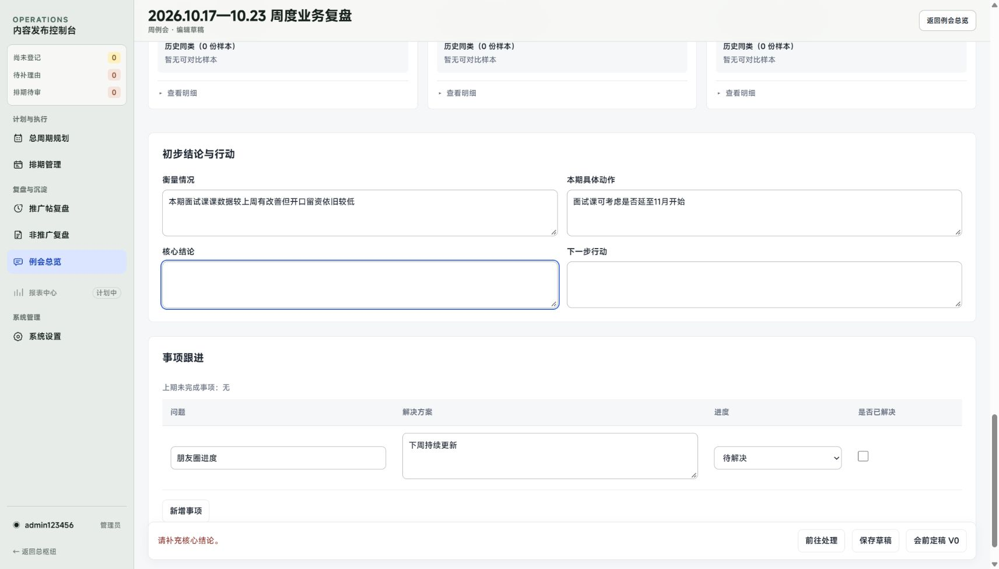

# 例会定稿反馈修复

已自检、已发布，待用户反馈。代码 `8e1d88f`；正式站点 [内容工作台](https://qiuyun-frontend.vercel.app/business/meeting-review)，部署 `dpl_QCN3SuAkqZLyqmn3gdTSqKpykhHS`。

定稿缺项现在明确提示并定位字段；来源变化引导刷新，服务错误与断网保留输入、允许重试，成功打开对应冻结版本。已确认非推广的隐藏字段禁用，避免原生精度校验静默拦截。必填规则及草稿、会前／会后业务门槛保持。

## 真实页面

公网现有草稿点击会前定稿后显示“请补充核心结论”，焦点进入该字段；一个保存按钮、无横向溢出。仅触发前端校验，未替用户填写或定稿。

## 隔离验收

截图和录像使用正式组件、隔离 PGlite 与虚构业务数据。以下图像与录像关键帧均已实际查看。

| 场景 | 结果与证据 |
| --- | --- |
| 缺项 | 候选、核心结论、点击率及范围、非推广未处理均明确提示并定位；[核心结论](missing-conclusion-1440.png) |
| 来源冲突 | 真实事务拒绝旧指纹且不生成版本，定位刷新并保留输入；[1920](source-changed-1920.png)、[1440](source-changed-1440.png)、[1280](source-changed-1280.png)、[1024](source-changed-1024.png) 无溢出 |
| 失败恢复 | 取消、非 JSON 503、断网保留输入，可重试；[服务错误](server-failure-1440.png) |
| 成功跳转 | 真实按钮写入并打开[会前 V0](pre-v0-success-1440.png)、[会后 V1](post-v1-success-1440.png)，连续点击仅提交一次 |
| 隐藏字段 | 非推广已确认四位精度指标不再阻止整表定稿 |

[定稿流程末段录像](finalization-flow.mp4) · [录像关键帧](flow-keyframes.png) · [专项检查](checks.json) · [公网 DOM 核对](production-read.json) · [公网检查](public-smoke.json)

182 项规则、类型检查、Node／Vercel 构建、db:check、例会内联完整流程及非推广专项通过。公网 85 项请求检查、57 个资源哈希一致。写入验收全部在隔离库完成，无数据库迁移；本轮桌面验收。
